<div align="center">

# 💎 r-ui

**Universal UI/UX Design System, Dual-Layer Theme Engine & 9-Pillar (45+ Component) Production Suite**

*A production-grade, anti-slop, project-adaptive design system & AI skill. Zero-dependency, zero-neon, anti-heavy shadows, strict componentized form policy, and 100% intellectual property (HAKI) compliant.*

[](https://github.com/RudyCity/r-ui)
[](LICENSE)
[](#)
[](#)
[](#)

[Live Interactive Playground](references/examples/r-ui-showcase.html) • [Dashboard Kit Spec](references/r-ui-dashboard-kit-spec.md) • [Design Tokens](references/r-ui-tokens.css) • [Themes](references/r-ui-themes.css) • [Component Specs](references/r-ui-component-specs.md) • [Framework Adapters](references/r-ui-framework-adapters.md)

</div>

---

## 🌟 Overview

`r-ui` is a universal design system and AI operational skill engineered to eradicate generic "AI-slop" interfaces and deliver complete, production-grade 9-pillar dashboard kits. Built on standard W3C CSS Custom Properties and zero-dependency TypeScript contracts, `r-ui` adapts seamlessly across:

- 🌐 **Web & PWA**: Chrome, Safari, Firefox, Edge, Arc (Core Web Vitals & Standalone PWA).
- 💻 **Desktop OS**: Windows (Fractional DPI), macOS (Retina), Linux (Tiling WM).
- 📱 **Mobile & Tablet**: Android, iOS, iPadOS (48dp Touch Targets, Safe Areas, Bottom Sheets).
- 📖 **Foldables & Dual-Screen**: Hinge-aware responsive CSS spanning.
- 📺 **10-Foot UI (Smart TV)**: D-Pad Spatial Navigation, 3-meter legibility, 5% overscan protection.

All tokens and classes operate under the original `--r-ui-*` namespace, guaranteeing **100% protection against third-party trademark and IP infringement**.

---

## 🛡️ The 9 Anti-Slop Visual Laws

```text
┌─────────────────────────────────────────────────────────────────────────────┐
│                       THE 9 ANTI-SLOP DESIGN LAWS                           │
├─────────────────────────────────────────────────────────────────────────────┤
│  1. BAN THE PURPLE HAZE     ──► No generic AI-purple/pink mesh gradients    │
│  2. BAN SYMMETRIC BENTO     ──► Asymmetric weights & hierarchy (2:1 spans)  │
│  3. BAN INTER MONOCULTURE   ──► Distinctive display + refined body font     │
│  4. BAN GLASS OVERDOSE      ──► Max blur 6-8px, crisp 1px borders only      │
│  5. BAN POINTLESS MOTION    ──► Purposeful haptic springs, no loop spin     │
│  6. BAN MOCK DATA VAGUENESS ──► Realistic domain data, zero "Lorem Ipsum"   │
│  7. BAN HEAVY MUDDY SHADOWS ──► Zero thick black blur; crisp micro-elevate  │
│  8. BAN NEON & CYBERPUNK    ──► Calibrated optical tones; zero glow rings   │
│  9. BAN RAW NATIVE FORMS    ──► Zero unstyled <select>; 100% componentized  │
└─────────────────────────────────────────────────────────────────────────────┘
```

---

## 🏛️ The 9-Pillar (45+ Component) Complete Dashboard Kit Architecture

When generating analytical consoles, SaaS backends, or dashboard kits, `r-ui` enforces the **9 Architectural Pillars**:

```mermaid
flowchart TD
    Dashboard["r-ui Universal Dashboard Kit"]
    
    Dashboard --> P1["1. Shell & Navigation"]
    Dashboard --> P2["2. Metrics & Telemetry"]
    Dashboard --> P3["3. Tables & Collections"]
    Dashboard --> P4["4. Data Visualization"]
    Dashboard --> P5["5. Form Suite (Zero Native)"]
    Dashboard --> P6["6. Feedback & Overlays"]
    Dashboard --> P7["7. Navigation & Discovery"]
    Dashboard --> P8["8. Identity & Content"]
    Dashboard --> P9["9. Real-Time & DevOps"]

    P1 --> P1_items["Sidebar Rail, Top Header, Breadcrumbs, Page Toolbar, Master-Detail Drawer"]
    P2 --> P2_items["KPI Stat Cards, Telemetry Ribbon, Sparklines, 90-Day Uptime Strip"]
    P3 --> P3_items["Data Grid, Sortable Headers, Bulk Action Bar, Pagination, Filter Facets & Chips"]
    P4 --> P4_items["Area Curves, Bar Grids, Donut Distribution, Histograms, Chart Tooltips"]
    P5 --> P5_items["Custom Select, Multi-Select Chips, Date Range Picker, Spring Switch, Dropzone"]
    P6 --> P6_items["Modal Dialogs, Slide-Over Drawers, Toast Stack, Destructive Alerts, Tooltips"]
    P7 --> P7_items["Command Palette Ctrl+K, Segmented Controls, Steppers, Tree Views"]
    P8 --> P8_items["Avatar Groups, Status Badges dengan Pulse Dot, Audit Timeline, Key-Value Grid"]
    P9 --> P9_items["Live Terminal Stream, Latency Pulse, Env Var Editor, Metric Dials"]
```



*Comprehensive blueprint & implementation guide:* [r-ui-dashboard-kit-spec.md](references/r-ui-dashboard-kit-spec.md).

---

## 🚫 Law 9: Strict Componentized Form Policy (Zero Raw Native Forms)

- **Strictly Bans Raw Native `<select>` & `<option>`**: Raw OS popups (Win32 / Cocoa) break dark themes with blinding white contrast and uncontrolled styling.
- **Mandates Accessible Custom Popover Components**: Trigger button, floating popover, live search filtering, full keyboard navigation (`ArrowUp`/`ArrowDown`/`Enter`/`Esc`), and W3C ARIA compliance (`role="combobox"`, `role="listbox"`, `role="option"`).

---

## 🎨 Dual-Layer Theming Engine

`r-ui` decouples **Canvas Themes** from **Accent Color Themes**, unlocking 40 clean visual pairings:

```html
<!-- Combine Canvas Theme and Color Accent freely -->
<html data-r-ui-theme="slate-obsidian" data-r-ui-accent="cyan">
```

### 1. Canvas Themes (`data-r-ui-theme`)
- **`dark-nebula`**: Refined modern dark tech (deep slate background `#07090e`).
- **`clean-light`**: Warm editorial paper light (`#f6f8fb`).
- **`slate-obsidian`**: Minimalist high-end dark tech (`#090c15`, zero-neon).
- **`warm-sepia`**: Classic editorial book & publication palette (`#fbf8f2`).
- **`high-contrast`**: Maximum accessibility WCAG 2.2 AAA black/white mode.

### 2. Calibrated Color Themes (`data-r-ui-accent`)
8 optical-grade scales with 50–950 brightness ramps:
- **`cyan`**: Precision Sky Blue
- **`emerald`**: Calibrated Emerald
- **`violet`**: Royal Studio Violet
- **`crimson`**: Ruby Crimson
- **`amber`**: Solar Amber
- **`monochrome`**: Titanium Slate
- **`frost`**: Nordic Teal
- **`coral`**: Sunset Coral

---

## 🎛️ Project DNA Adaptation: The 4 Visual Dials

Interfaces must never look rigid. Calibrate the 4 dials before engineering components:

```text
┌─────────────────────────────────────────────────────────────────────────────┐
│                      THE 4 r-ui ADAPTIVE PROJECT DIALS                      │
├─────────────────────────────────────────────────────────────────────────────┤
│  1. VISUAL DENSITY    ──► 1 (Airy / Luxury)  ◄──────► 10 (Compact Cockpit)  │
│  2. CORNER RADIUS     ──► 0px (Sharp Brutal) ◄──────► 9999px (Pill Playful) │
│  3. MOTION INTENSITY  ──► 1 (Static Calm)    ◄──────► 10 (Cinematic Spring) │
│  4. CONTRAST LEVEL    ──► Subtle / Muted     ◄──────► High Contrast AAA     │
└─────────────────────────────────────────────────────────────────────────────┘
```

### 5 Project Archetypes:
1. **High-Density B2B Cockpit**: Density 8–9, Radius 4px (Trading, Analytics, ERP).
2. **Consumer Playful / Lifestyle**: Density 4–5, Radius 12–16px (E-Commerce, Social).
3. **Minimalist Swiss / Editorial**: Density 3–4, Radius 0–2px (Portfolios, Luxury).
4. **Minimalist Precision Dark Tech**: Density 7–8, Radius 4–6px (DevTools, Cloud, AI Workbenches).
5. **Regulated & Public Sector**: Density 5–6, Radius 6–8px (Government, Medical, WCAG AAA).

---

## 🚀 Quick Start

### Option A: Use as an AI Coding Agent Skill
Copy this repository into your AI skill directory:

```bash
# Antigravity / Gemini CLI
cp -r r-ui ~/.gemini/config/skills/r-ui

# Claude Code / Superagent Workspace
cp -r r-ui .agents/skills/r-ui
```

### Option B: Use in Pure Web Projects
Import the base CSS files in your HTML or CSS entry point:

```html
<link rel="stylesheet" href="references/r-ui-tokens.css">
<link rel="stylesheet" href="references/r-ui-themes.css">
<link rel="stylesheet" href="references/r-ui-color-themes.css">
```

### Option C: Use with Tailwind CSS (v3 / v4)

**Tailwind v4 (`globals.css`):**
```css
@import "tailwindcss";
@import "./references/r-ui-tokens.css";
@import "./references/r-ui-themes.css";

@theme {
  --color-r-ui-canvas: var(--r-ui-color-canvas);
  --color-r-ui-surface: var(--r-ui-color-surface);
  --color-r-ui-border: var(--r-ui-color-border-standard);
  --color-r-ui-accent: var(--r-ui-color-accent-primary);
}
```

### Option D: Headless / Unstyled Mode
Strip all opinionated styles and apply pure utility classes without conflict:

```tsx
<Card unstyled className="bg-slate-900 border border-slate-800 rounded-xl p-6 hover:border-slate-700">
  <Card.Title className="text-xl font-bold text-slate-100">
    Custom Workbench
  </Card.Title>
  <Card.Body className="text-slate-400 mt-2 text-sm">
    Unstyled mode gives 100% design flexibility.
  </Card.Body>
</Card>
```

---

## 🎮 Live Interactive Showcase

Open [`references/examples/r-ui-showcase.html`](references/examples/r-ui-showcase.html) directly in any modern browser—no server or build tools required:

- **Theme & Accent Switcher**: Switch canvas and 8 accents live with zero-flicker transitions.
- **Adaptive Modal**: Desktop popup transforms into a mobile bottom-sheet on smaller screens.
- **Smart TV Spatial Nav**: Use arrow keys to experience 1.08x D-pad navigation and crisp outlines.
- **Modality Detection**: Detects touch vs precision mouse pointer automatically.

---

## 📚 Curated Design References

`r-ui` incorporates audited design patterns from the world's best design archives:
1. **[jiro.build](https://jiro.build)**: 1,400+ production component layouts and bento blocks.
2. **[designspells.com](https://designspells.com)**: Delight moments, spring physics, and micro-interactions.
3. **[styles.refero.design](https://styles.refero.design)**: Real audited typography pairings and color tokens.
4. **[supahero.io](https://supahero.io)**: High-impact hero layouts and header architectures.
5. **[mobbin.com](https://mobbin.com)**: Real app user flows, bottom sheets, and transition patterns.

---

## 📁 Repository Structure

```text
r-ui/
├── SKILL.md                          # Main operational AI skill manual (v2.2.0)
├── README.md                         # Public repository documentation
├── LICENSE                           # MIT License
└── references/
    ├── r-ui-dashboard-kit-spec.md    # 9-Pillar (45+ Component) Master Blueprint
    ├── r-ui-tokens.css               # Core W3C CSS design tokens
    ├── r-ui-themes.css               # 5 Canvas themes
    ├── r-ui-color-themes.css         # 8 Calibrated accent color themes
    ├── r-ui-component-specs.md       # Visual component specifications (Buttons, Inputs, Select, Tables, Modals, etc.)
    ├── r-ui-project-adapter.md       # 4 Project dials & 5 archetypes guide
    ├── r-ui-config-schema.json       # Formal JSON Schema for project configuration
    ├── r-ui-responsive-matrix.md     # Cross-platform engineering recipes
    ├── r-ui-framework-adapters.md    # React, Tailwind, Vue, Svelte, Ink CLI guides
    ├── r-ui-modular-architecture.md  # 5-level atomic modular hierarchy
    ├── r-ui-contract-types.ts        # Zero-dependency TypeScript contracts
    ├── r-ui-compound-components.tsx  # Production Compound Components (Select, Card, Modal, etc.)
    ├── r-ui-theme-switcher.tsx       # Interactive Theme & Accent Switcher widget
    └── examples/
        ├── r-ui-showcase.html        # Zero-dependency interactive live playground
        └── README.md                 # Playground testing instructions
```

---

## 📄 License

Distributed under the **MIT License**. See [`LICENSE`](LICENSE) for details.

---

<div align="center">
  <b>Built with precision by <a href="https://github.com/RudyCity">RudyCity</a></b>
</div>
