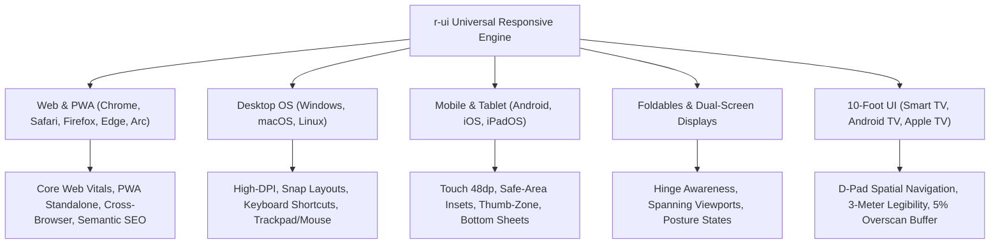

--
name: r-ui
description: Universal UI/UX Design System, Multi-Theme, Modular Color Accent, 9-Pillar Complete Dashboard Kit Architecture (45+ Production Components), Spatial Harmony & Layout Precision Doctrine, Color Science & Palette Architecture (60-30-10, Tonal Ramps, Undertones), Typographic Composition Doctrine (3-Tier Font Pairing, Modular Scale, Leading Ratios, Tracking Inversion, 3-Weight Discipline), Project-Adaptive & Live Playground Architecture Skill. Enforces anti-slop aesthetic standards, anti-rigid project adaptation (5 project archetypes & 4 visual dials), zero-neon and anti-heavy shadow discipline, visual-first density, dual-layer theming (5 Canvas Themes + 8 Calibrated Color Themes), strict componentized form policy (zero raw native forms), headless/unstyled component flexibility, live interactive showcase, multi-framework integration (React, Next.js, Tailwind v3/v4, Vue, Svelte, Ink CLI), fluid cross-platform responsiveness (Web, Windows, macOS, Linux, Android, iOS, Foldables, Smart TV), and integration with curated design references (jiro.build, designspells.com, styles.refero.design, supahero.io, mobbin.com).
when_to_use: Use whenever designing, building, auditing, refactoring, or reviewing user interfaces (UI), user experiences (UX), dashboard kits, admin consoles, SaaS platforms, responsive layouts, design systems, design tokens, micro-interactions, components, color themes, project adaptation, interactive showcases, or cross-platform web/app experiences.
version: 2.4.0
---

# r-ui: Universal UI/UX Design System & Visual-First Architecture

`r-ui` adalah skill panduan operasional orisinal untuk merancang antarmuka (UI) dan pengalaman pengguna (UX) berskala produksi berestetika agensi papan atas: **Visual-First**, **Padat & Ringkas (Anti-Wall-of-Text)**, **Bebas dari Shadow Keruh/Pekat**, **Bebas dari Efek Neon & Cyberpunk**, **Adaptif terhadap DNA Proyek**, dan **Bebas Risiko HAKI** (100% menggunakan namespace orisinal `--r-ui-*`).

---

## 1. THE 10 ANTI-SLOP VISUAL LAWS (Non-Negotiable)

```text
┌─────────────────────────────────────────────────────────────────────────────┐
│                       THE 10 ANTI-SLOP DESIGN LAWS                          │
├─────────────────────────────────────────────────────────────────────────────┤
│  1. BAN THE PURPLE HAZE     ──► No generic AI-purple/pink mesh gradients    │
│  2. BAN SYMMETRIC BENTO     ──► Asymmetric weights & hierarchy (2:1 spans)  │
│  3. BAN INTER MONOCULTURE   ──► Distinctive display + refined body font     │
│  4. BAN GLASS OVERDOSE      ──► Max blur 6-8px, crisp 1px borders only      │
│  5. BAN POINTLESS MOTION    ──► Purposeful haptic springs, no loop spin     │
│  6. BAN MOCK DATA VAGUENESS ──► Realistic domain data, zero "Lorem Ipsum"   │
│  7. BAN HEAVY MUDDY SHADOWS ──► Zero thick black blur; crisp micro-elevate  │
│  8. BAN NEON & CYBERPUNK    ──► Calibrated optical tones; zero glow rings   │
│  9. BAN RAW NATIVE FORMS    ──► Zero unstyled <select>; 100% componentized  │
│ 10. BAN COLOR HIJACKING     ──► Honor existing color system; zero rogue hex │
└─────────────────────────────────────────────────────────────────────────────┘
```

---

## 2. THE 5 GOLDEN DESIGN REFERENCES (Curated Standards)

Selalu jadikan 5 referensi terkurasi berikut sebagai standar rujukan utama:

| Pilar Referensi | Sumber Rujukan | Area Fokus Utama |
|:---|:---|:---|
| **1. Modern Components & Bento** | **[jiro.build](https://jiro.build)** *(MCP `jiro`)* | 1,400+ desain komponen produksi, blok bento asimetris, kartu interaktif, pricing tables. |
| **2. Delight & Micro-interactions** | **[designspells.com](https://designspells.com)** | Micro-interactions taktil, fisika pegas (*fluid spring physics*), feedback hover presisi. |
| **3. Audited Type & Color Systems** | **[styles.refero.design](https://styles.refero.design)** | Sistem warna nyata produk digital dunia, pasangan tipografi display vs body teruji. |
| **4. High-Impact Hero Layouts** | **[supahero.io](https://supahero.io)** | Arsitektur hero section bertenaga tinggi, visual value proposition, header navigation. |
| **5. Real App Flows & Journeys** | **[mobbin.com](https://mobbin.com)** *(MCP `mobbin`)* | Alur onboarding, drawer navigation, dialog transitions, dan empty state nyata. |

---

## 3. PROJECT DNA ADAPTATION & VISUAL DIALS

`r-ui` menolak desain kaku (*anti-rigid*). Kalibrasikan 4 dial visual sebelum merancang komponen:

```text
┌─────────────────────────────────────────────────────────────────────────────┐
│                      THE 4 r-ui ADAPTIVE PROJECT DIALS                      │
├─────────────────────────────────────────────────────────────────────────────┤
│  1. VISUAL DENSITY    ──► 1 (Airy / Luxury)  ◄──────► 10 (Compact Cockpit)  │
│  2. CORNER RADIUS     ──► 0px (Sharp Brutal) ◄──────► 9999px (Pill Playful) │
│  3. MOTION INTENSITY  ──► 1 (Static Calm)    ◄──────► 10 (Cinematic Spring) │
│  4. CONTRAST LEVEL    ──► Subtle / Muted     ◄──────► High Contrast AAA     │
└─────────────────────────────────────────────────────────────────────────────┘
```

### 5 Arketipe Proyek Inti:
1. **High-Density B2B Cockpit** *(Trading, ERP, CRM, Analytics)*: Density 8–9, Radius 4px, Motion 1–2 (Padding kompak 8–12px, font 13–14px, kecepatan input maksimal).
2. **Consumer Playful / Lifestyle** *(E-Commerce, Social, EdTech)*: Density 4–5, Radius 12–16px, Motion 7–8 (Spasi lega 24–32px, micro-border halus, haptic spring).
3. **Minimalist Swiss / Editorial** *(Portfolio, Agency, Publishing)*: Density 3–4, Radius 0px–2px, Motion 2–3 (Ruang negatif luas, border 1px tegas, kontras tipe tinggi).
4. **Minimalist Precision Dark Tech** *(DevTools, AI Workbenches, Cloud)*: Density 7–8, Radius 4px–6px, Motion 3–4 (Kanvas gelap pekat `#0b0f19`, teks tajam `#f9fafb`, zero-neon).
5. **Regulated & Public Sector** *(Layanan Publik, Medis, Legal)*: Density 5–6, Radius 6px–8px, Motion 1–2 (Target sentuh 48px, WCAG AAA, zero-transparency).

*Panduan lengkap:* [r-ui-project-adapter.md](references/r-ui-project-adapter.md) dan [r-ui-config-schema.json](references/r-ui-config-schema.json).

---

## 4. UNIVERSAL MULTI-DEVICE & CROSS-PLATFORM MATRIX



*Panduan lengkap resep:* [r-ui-responsive-matrix.md](references/r-ui-responsive-matrix.md).

---

## 5. DUAL-LAYER THEME SYSTEM (CANVAS + COLOR THEMES)

```html
<!-- Contoh Kombinasi Bebas -->
<html data-r-ui-theme="dark-nebula" data-r-ui-accent="emerald">
<!-- Atau Slate Obsidian dengan Aksen Crimson -->
<html data-r-ui-theme="slate-obsidian" data-r-ui-accent="crimson">
```

- **5 Canvas Themes**: `dark-nebula` (Dark Tech), `clean-light` (Warm Light), `slate-obsidian` (High-End Dark), `warm-sepia` (Editorial Paper), `high-contrast` (WCAG AAA).
- **8 Calibrated Color Accents**: `cyan`, `emerald`, `violet`, `crimson`, `amber`, `monochrome`, `frost`, `coral` (Semua terkalibrasi optik, zero-neon).

*Spesifikasi warna:* [r-ui-color-themes.css](references/r-ui-color-themes.css) dan [r-ui-themes.css](references/r-ui-themes.css).

---

## 6. MODULAR CODE DELIVERABLES

- 🏛️ **Master Blueprint Dashboard Kit (9 Pilar & 45+ Komponen)**: [r-ui-dashboard-kit-spec.md](references/r-ui-dashboard-kit-spec.md)
- 📜 **Boilerplate Kontrak Tipe TS**: [r-ui-contract-types.ts](references/r-ui-contract-types.ts)
- 📦 **Compound Components (`unstyled?: boolean`)**: [r-ui-compound-components.tsx](references/r-ui-compound-components.tsx)
- 🎛️ **Widget Pemilih Tema & Aksen Interaktif**: [r-ui-theme-switcher.tsx](references/r-ui-theme-switcher.tsx)
- ⚙️ **Adapter Multi-Framework (React, Tailwind, Vue, Svelte, Ink)**: [r-ui-framework-adapters.md](references/r-ui-framework-adapters.md)
- 🏛️ **Tata Kelola Arsitektur Modular Atomik**: [r-ui-modular-architecture.md](references/r-ui-modular-architecture.md)
- 🎮 **Interactive Live Showcase**: [r-ui-showcase.html](references/examples/r-ui-showcase.html)

---

## 7. COMPLETE TECHNICAL REFERENCES

- 🏛️ **Spesifikasi Lengkap Dashboard Kit**: [r-ui-dashboard-kit-spec.md](references/r-ui-dashboard-kit-spec.md)
- 🎨 **Token Desain Standar**: [r-ui-tokens.css](references/r-ui-tokens.css)
- 📐 **Spesifikasi Komponen Visual**: [r-ui-component-specs.md](references/r-ui-component-specs.md)
- 📱 **Panduan Responsif Multi-Device**: [r-ui-responsive-matrix.md](references/r-ui-responsive-matrix.md)
- 🕹️ **Dokumentasi Contoh Playground**: [README.md](references/examples/README.md)

---

## 8. PRE-FLIGHT UI/UX AUDIT CHECKLIST (22-Point Gate)

```text
[ ] 1.  Anti-Slop Check: Bebas dari AI-purple mesh gradient, bento seragam, & teks dummy "Lorem".
[ ] 2.  Anti-Neon Check: Bebas dari warna fluorescent menusuk mata dan efek glowing box-shadow.
[ ] 3.  Anti-Heavy Shadow Check: Bebas dari shadow keruh hitam tebal; gunakan micro-elevation 1-3px.
[ ] 4.  Visual Density: Teks penjelasan padat & ringkas, hierarki visual kuat, spasi 4pt/8pt.
[ ] 5.  Project DNA Match: Dials (Density, Radius, Motion, Contrast) sesuai arketipe proyek.
[ ] 6.  HAKI Compliance: Seluruh token baku dan kelas CSS menggunakan prefix orisinal --r-ui-*.
[ ] 7.  Mobile Ergonomics: Target sentuh min 44x44px, bottom-sheet di layar kecil, safe-area-inset.
[ ] 8.  Desktop Multi-Window: Fractional DPI crisp scaling, hotkeys navigasi jelas.
[ ] 9.  10-Foot UI (TV): D-Pad spatial navigation (Arrow keys), perbesaran 1.08x, outline kontras.
[ ] 10. Contrast Ratio: Lolos WCAG 2.2 AA (min 4.5:1 untuk teks normal, 3:1 teks besar).
[ ] 11. Dual-Layer Theming: Elemen merespons pergantian data-r-ui-theme dan data-r-ui-accent.
[ ] 12. Fluid Typography: Menggunakan clamp() proporsional, tanpa layout break saat di-zoom.
[ ] 13. Spring Motion: Menggunakan kurva spring cubic-bezier(0.16, 1, 0.3, 1), durasi 180-260ms.
[ ] 14. Modality Awareness: Komponen membedakan input sentuh (touch) vs mouse presisi.
[ ] 15. Unstyled Flexibility: Mendukung mode unstyled?: boolean untuk styling bebas.
[ ] 16. Zero-Dependency: Tidak ada library eksternal wajib yang dipaksakan.
[ ] 17. Componentized Form Check: 100% bebas dari elemen raw native <select>, checkbox, atau radio; seluruhnya menggunakan r-ui Custom Form Components.
[ ] 18. Dashboard Completeness Gate: Meliputi ke-9 pilar arsitektur dashboard kit (Shell, Telemetri, Data Table, Visualisasi, Form kustom, Overlay, Navigasi, Identitas, dan Konsol DevOps).
[ ] 19. Existing Color & Theme Conformance: Telah melakukan audit sistem warna eksisting dan memastikan 100% elemen baru/modifikasi tunduk pada CSS variables, tokens, dan tema yang sudah ada (zero rogue hardcoded hex/rgb).
[ ] 20. Spatial Rhythm & Layout Harmony: Rasio ruang kosong (macro/micro whitespace) pas, rapi, dan teratur mengikuti skala 4pt/8pt; padding kontainer seimbang dengan konten; zero trapped dead-space, zero layout breaking, dan alignment presisi.
[ ] 21. Color Palette & Undertone Coherence: Menerapkan rasio proporsi 60-30-10; nuansa netral konsisten (cool/slate, neutral/zinc, atau warm/stone); aksen terkalibrasi (<=10%); bebas dari warna neon fluorescent menusuk mata.
[ ] 22. Typographic Composition & Tracking Discipline: Mematuhi pasangan 3-tier font (Display, UI/Body, Tabular Mono); leading proporsional (tight 1.1-1.2 untuk judul besar, compact 1.35 untuk UI, 1.6 untuk prosa); menerapkan hukum inversi tracking (-0.02em pada judul, +0.06em pada micro-label/caps); disiplin maks 3 font-weight.
```

---

## 9. STRICT COMPONENTIZED FORM POLICY (Zero Raw Native Forms)

Agen **DILARANG KERAS** menggunakan elemen form HTML mentah bawaan browser (*raw native unstyled form elements*), terutama elemen native `<select>` dan `<option>`.

### Mengapa Native `<select>` Dilarang?
- Menu popup `<option>` bawaan sistem operasi (Windows Win32, macOS popup) tidak mematuhi CSS variables, merusak mode gelap (*dark canvas*), tidak dapat disesuaikan tipografinya, dan merusak keselarasan visual antarmuka.
- Dropdown native tidak mendukung *search filtering*, *multi-select chips*, *custom icons*, maupun animasi transisi spring.

### Standar Wajib: r-ui Custom Accessible Form Components
Setiap form pemilihan wajib menggunakan **r-ui Custom Select Component**:
- **Trigger Button**: Memiliki label aktif, ikon status, dan custom chevron SVG yang berputar halus saat dibuka.
- **Floating Popover Menu**: Permukaan mengambang dengan micro-elevation tajam (`--r-ui-shadow-lg`), border 1px halus, dan latar yang sepenuhnya selaras dengan tema kanvas aktif.
- **Searchable / Filterable**: Mendukung penyaringan opsi secara instan saat opsi berjumlah > 5.
- **Full Keyboard Navigation**: Mendukung navigasi panah (`ArrowUp` / `ArrowDown`), pemilihan via `Enter` / `Space`, dan penutupan via `Escape`.
- **W3C ARIA Accessible**: Menggunakan atribut `role="listbox"`, `role="option"`, `aria-expanded`, dan `aria-selected`.

---

## 10. MANDATORY 9-PILLAR (45+ COMPONENT) ARCHITECTURE FOR DASHBOARD KITS

Setiap kali diminta membuat Dashboard Kit atau UI Kit dengan `r-ui`, agen **WAJIB MENYEDIAKAN SUITE LENGKAP 9 PILAR (45+ KOMPONEN)**, tidak boleh hanya layout monitoring/cockpit parsial:

1. **Pilar 1 — Shell & Navigation**: Collapsible Sidebar (Expanded 240px & Mini-Rail 60px), Workspace/Org Switcher, Top Header, Breadcrumb Trail, Page Action Toolbar, Master-Detail Inspector Drawer.
2. **Pilar 2 — Metrics & Telemetry**: High-Density Stat Cards (Value, Delta %, Context Subtitle), Architectural Telemetry Ribbon (Anti-Card Overuse), Segmented Quota Gauges, 90-Day Uptime Strip & Live Latency Pulse Dot.
3. **Pilar 3 — Data Tables & Collections**: High-Density Data Grid, Sortable Headers, Custom Row Checkbox (Indeterminate Support), Floating Bulk Action Bar, Pagination & Page Size Selector, Faceted Filter Popovers & Active Filter Chips, Empty States, Skeleton Shimmer.
4. **Pilar 4 — Data Visualization**: Time-Series Area Curves dengan interactive crosshair, Grouped/Stacked Bar Charts, Donut Distribution dengan center aggregate & legend, Latency Histogram, Interactive Chart Tooltips.
5. **Pilar 5 — Form & Inputs (Zero Native Forms)**: Custom Accessible Select (Searchable, Popover), Multi-Select with Removable Chips, Date & Date-Range Picker, Prefix/Suffix Inputs, Number Steppers, Textarea with Counter, Tactile Spring Switch, Custom Checkbox & Radio Cards, Dual-Thumb Range Slider, Drag-and-Drop Dropzone.
6. **Pilar 6 — Feedback, Overlays & Drawers**: Modal Dialogs dengan backdrop blur, Slide-Over Sheet / Inspector Drawer kanan, Slide-in Toast Stack (Success/Error/Warning/Info/Undo), Alert Banners, Destructive Confirmation Dialog, Tooltips mikro, Context Menu Popover.
7. **Pilar 7 — Navigation & Wayfinding**: Command Palette (`Ctrl+K` / `⌘+K`) dengan fuzzy search, Segmented Controls, Line/Pill Tabs, Stepper / Multi-Step Wizard, Tree Views.
8. **Pilar 8 — Identity, Display & Content**: Avatars & Stacked Avatar Groups dengan online presence dot, Status Badges dengan animasi pulse dot, Activity Timeline / Audit Feed, Key-Value Metadata Grid, Code Snippet & JSON Inspector.
9. **Pilar 9 — Real-Time & DevOps Consoles**: Live Streaming Monospace Terminal Console (INFO/WARN/ERR/DEBUG, auto-scroll lock, log search), Secret Masking Env Var Editor, Latency Ping Meter.
10. **Interactive Component Showcase**: Wajib menyertakan tab/halaman katalog interaktif di mana seluruh komponen dari ke-9 pilar dapat diuji fungsionalitas dan respon temanya secara live.

*Spesifikasi teknis & blueprint lengkap:* [r-ui-dashboard-kit-spec.md](references/r-ui-dashboard-kit-spec.md).

---

## 11. MANDATORY EXISTING COLOR & THEME CONFORMANCE PROTOCOL

Setiap kali agen membuat komponen baru, merefaktor kode, atau memodifikasi antarmuka di proyek yang sudah ada, agen **WAJIB MEMATUHI PROTOKOL 4 LANGKAH INI SEBELUM MEMULAI CODING**:

```text
┌─────────────────────────────────────────────────────────────────────────────┐
│             EXISTING COLOR & THEME CONFORMANCE WORKFLOW                     │
├─────────────────────────────────────────────────────────────────────────────┤
│ 1. DISCOVERY & MAPPING ──► Audit :root, tokens, CSS vars, & active themes   │
│ 2. ZERO ROGUE COLORS   ──► Ban hardcoded hex/rgb; 100% map to existing vars │
│ 3. THEME REACTIVITY    ──► Ensure dynamic adaptation to dark/light/accents  │
│ 4. FORMAL EXTENSION    ──► Derive only from existing ramps (50-950 / alpha) │
└─────────────────────────────────────────────────────────────────────────────┘
```

### Langkah 1: Audit Sistem Warna & Tema Eksisting (Pre-Flight Inspection)
Sebelum menulis satu baris pun CSS atau styling:
1. **Telusuri Berkas Token & Styling**: Periksa `:root`, `tokens.css`, `themes.css`, `globals.css`, `tailwind.config`, atau atribut HTML seperti `data-theme`, `data-r-ui-theme`, `data-r-ui-accent`.
2. **Petakan Peran Semantik (Semantic Roles)**:
   - **Kanvas & Permukaan**: Cari token background dasar (misal `--r-ui-color-canvas`, `--r-ui-color-surface`, `--r-ui-color-surface-elevated`).
   - **Batas & Hairlines**: Cari token border (misal `--r-ui-color-border-standard`, `--r-ui-color-border-subtle`).
   - **Hierarki Teks**: Cari token tipografi (misal `--r-ui-color-text-primary`, `--r-ui-color-text-secondary`, `--r-ui-color-text-tertiary`).
   - **Aksen & State Interaktif**: Cari token brand/aksen (misal `--r-ui-color-accent-primary`, `--r-ui-color-focus-ring`, `--r-ui-color-success`, `--r-ui-color-error`).

### Langkah 2: Dilarang Keras Memasukkan Hex/RGB Liar (Zero Rogue Hardcoded Colors)
- **Hukum Mutlak**: Agen **DILARANG KERAS** menuliskan warna hardcoded sembarangan seperti `background: #1e293b; color: #64748b;` jika proyek sudah memiliki sistem CSS variables seperti `var(--r-ui-color-surface-elevated)` atau `var(--r-ui-color-text-secondary)`.
- Seluruh elemen baru atau modifikasi **100% WAJIB MEMAKAI CSS VARIABLES / DESIGN TOKENS EKSISTING**.
- Pelanggaran terhadap sistem warna eksisting dianggap sebagai **SLOP & DESAIN INKONSISTEN**.

### Langkah 3: Pengujian Reaktivitas Multi-Tema (Theme-Reactivity)
- Seluruh elemen yang dimodifikasi atau baru ditambahkan wajib diuji terhadap perubahan tema aktif (misal dari mode Dark Nebula ke Clean Light atau Slate Obsidian).
- Tidak boleh ada elemen dengan warna teks/background statis yang menjadi tidak terbaca (*contrast broken*) saat pengguna berpindah tema.

### Langkah 4: Protokol Ekstensi Warna Terkendali
- Jika sebuah komponen membutuhkan transparansi atau variasi warna yang belum tersedia, **DILARANG** mengarang warna baru.
- Gunakan fungsi `rgba()` berbasis token aksen yang ada (misal `rgba(var(--r-ui-color-accent-primary-rgb), 0.15)`) atau gunakan skala ramp terdaftar (`--r-ui-color-accent-50` hingga `950`).
- Jika penambahan token permanen memang diperlukan, daftarkan token tersebut secara formal di file token utama proyek terlebih dahulu dengan persetujuan hierarki desain.


---

---

## 12. SPATIAL HARMONY & PRECISION LAYOUT DOCTRINE (Macro/Micro Whitespace, Container Balance & Visual Cleanliness)

Desain antarmuka berkelas dunia dicirikan oleh **kebersihan (clean), kerapian (neatness), presisi matematis (precision), konsistensi (consistency), serta harmoni yang pas antara ruang kosong (negative space) dan isi kontainer (content)**. Ruang kosong bukanlah "area terbuang", melainkan elemen struktural aktif yang memandu mata, memberi ruang bernapas (*cognitive breathing room*), dan menciptakan hierarki intuitif.

```text
+---------------------------------------------------------------------------------+
|                     THE 5 PILLARS OF SPATIAL HARMONY                            |
+-----------------+-----------------+-----------------+-------------+-------------+
| 1. 4pt/8pt Grid | 2. Gestalt Space| 3. Nested Radius| 4. Density  | 5. Optical  |
| Strict Harmonic | Macro vs Micro  | R_outer =       | Zero Dead   | Tabular &   |
| Multiples Only  | Proximity Ratios| R_inner + P     | Space Bounds| Axis Lock   |
+-----------------+-----------------+-----------------+-------------+-------------+
```

### 12.1. Hukum Grid Harmonik 4pt / 8pt (Strict Spatial Multiples)
Setiap nilai `padding`, `margin`, `gap`, `width`, dan `height` struktural **WAJIB MERUPAKAN KELIPATAN DARI 4px ATAU 8px**.
- **Dilarang Keras Nilai Acak/Ganjil**: Jangan pernah menuliskan padding/margin sembarangan seperti `margin-top: 13px;`, `gap: 17px;`, `padding: 22px;`, atau `width: 317px;`.
- **Skala Spasi Standar r-ui**:
  - `4px` (`--r-ui-space-1`): Micro-gap (ikon ke label teks, dot status ke teks, tag badge padding vertikal).
  - `8px` (`--r-ui-space-2`): Compact-gap (jarak antar input grup, padding elemen list, button compact).
  - `12px` (`--r-ui-space-3`): Standard-inner (gap form fields, padding stat card kompak, margin subtitle).
  - `16px` (`--r-ui-space-4`): Container standard (padding card utama, gap flexbox standar, grid gap).
  - `24px` (`--r-ui-space-6`): Macro-gap (jarak antar card besar, padding modal dialog, padding page toolbar).
  - `32px` (`--r-ui-space-8`): Section separation (jarak antar section besar, outer container padding).
  - `48px` / `64px` (`--r-ui-space-12` / `16`): Hero section, empty state padding, or dashboard layout split.

### 12.2. Hukum Kedekatan Gestalt & Rasio Spasi (Macro vs Micro Whitespace)
Elemen yang saling berhubungan secara fungsional harus berada lebih dekat satu sama lain (*micro space*) daripada dengan elemen lain yang berbeda (*macro space*).
- **Aturan Rasio 1.5x - 2x**:
  $$\text{Section Gap (24-32px)} > \text{Card Padding (16-24px)} > \text{Item Gap (8-12px)} > \text{Label-to-Input (4-6px)}$$
- **Contoh Kesalahan Slop**: Judul card berjarak 20px dari isinya, tetapi jarak antar dua card hanya 12px. Ini merusak keterbacaan (*visual grouping breakdown*).
- **Aturan Hirarki Grup**:
  ```css
  /* BENAR: Hierarki spasi bertingkat */
  .r-ui-stat-card {
    padding: 16px;          /* Container padding */
    display: flex;
    flex-direction: column;
    gap: 12px;              /* Macro internal gap */
  }
  .r-ui-stat-card-header {
    display: flex;
    align-items: center;
    gap: 8px;               /* Micro icon-to-title gap */
  }
  .r-ui-stat-card-value {
    font-size: 24px;
    line-height: 1.2;
    margin-bottom: 2px;     /* Ultra-tight title to delta */
  }
  ```

### 12.3. Hukum Radius Bersarang Matematis (Nested Radius Formula)
Ketika sebuah elemen berada di dalam kontainer yang memiliki sudut membulat (`border-radius`), radius elemen dalam **TIDAK BOLEH SAMA DENGAN ATAU LEBIH BESAR DARI** radius luar.
- **Formula Konsentris Murni**:
  $$R_{\text{inner}} = \max(0, R_{\text{outer}} - \text{Padding})$$
- Jika kontainer luar memiliki $R_{\text{outer}} = 16\text{px}$ dan padding internal $\text{Padding} = 12\text{px}$, maka radius elemen anak di dalamnya wajib:
  $$R_{\text{inner}} = 16\text{px} - 12\text{px} = 4\text{px}$$
- **Mengapa ini krusial?** Jika elemen dalam memakai radius yang sama dengan kontainer luar (misal keduanya `16px`), sudut lengkungan akan bertabrakan (*corner pinch collision*) dan tampak seperti desain amatir.

### 12.4. Rasio Kontainer terhadap Konten & Zero Trapped Dead-Space
- **Anti Trapped Dead-Space**: Jangan pernah menempatkan konten kecil (misal 1 baris teks atau 1 tombol) di dalam kontainer raksasa `width: 100%` selebar 1400px tanpa batasan maksimal. Selalu gunakan `max-width` yang proporsional:
  - *Formulir & Pengaturan*: `max-width: 640px` atau `720px`.
  - *Teks Bacaan & Paragraf*: `max-width: 65ch` hingga `72ch` (panjang optimal baris bacaan mata manusia).
  - *Stat Cards / Metrics*: `grid-template-columns: repeat(auto-fit, minmax(260px, 1fr));`.
- **Anti Claustrophobia**: Konten teks tidak boleh menempel rapat ke batas tepi kontainer. Berikan padding minimal `16px` pada kartu desktop dan `12px` pada kartu mobile.
- **Harmoni Asimetris Vertikal (Optical Header Ratio)**:
  - Header kartu harus selalu lebih padat daripada isi tubuh kartu ($P_{\text{header-v}} \approx 0.75 \times P_{\text{card-v}}$).

### 12.5. Presisi Penyelarasan Optik & Angka Tabular (Alignment & Baselines)
- **Angka Tabular Wajib pada Dashboard**: Seluruh angka numerik pada tabel, statistik, saldo, latency meter, dan harga **WAJIB** menggunakan:
  ```css
  font-variant-numeric: tabular-nums;
  text-align: right; /* untuk data komparasi tabel */
  ```
  Hal ini mencegah angka bergeser/berguncang secara horizontal (*jittering*) ketika nilainya berubah atau saat dibanding-bandingkan di kolom tabel.
- **Vertical Centering Sumbu Optis**: Setiap kombinasi `icon + text` atau `badge + title` wajib menggunakan `display: inline-flex; align-items: center; gap: 6px;` untuk mengunci sumbu horizontal yang presisi.
- **Baseline Alignment**: Pada form berdampingan (misal input text di samping tombol submit), pastikan `height` keduanya tepat sama (misal sama-sama `36px` atau `40px`) dan `box-sizing: border-box;` aktif sehingga tidak terjadi perbedaan 1px offset.

### 12.6. Audit Mandatori Kerapian Layout (Layout Hygiene Gate)
Sebelum menyatakan layout atau komponen selesai dibuat:
1. `[ ]` Apakah seluruh padding dan margin mengikuti kelipatan skala 4px/8px?
2. `[ ]` Apakah rasio ruang kosong terasa lega namun tidak terasa hampa (tidak ada *trapped dead-space*)?
3. `[ ]` Apakah elemen bersarang mematuhi formula $R_{\text{inner}} = R_{\text{outer}} - P$?
4. `[ ]` Apakah seluruh angka numerik menggunakan `tabular-nums` dan tersusun rapi?
5. `[ ]` Apakah kontainer merespons ukuran layar secara fleksibel tanpa horizontal scrollbar yang tidak disengaja?


---

## 13. COLOR SCIENCE & PALETTE ARCHITECTURE (The 60-30-10 Rule, Undertone Families, 9-Step Tonal Ramps & Semantic Feedback Harmony)

Penggunaan warna pada antarmuka kelas dunia bukanlah sekadar dekorasi, melainkan **sistem komunikasi hierarki optis yang presisi**. Agen yang menggunakan `r-ui` wajib memahami dan menerapkan sains pewarnaan berikut:

```text
+-----------------------------------------------------------------------------------------+
|                         THE 60-30-10 SPATIAL COLOR FORMULA                              |
+------------------------------------+--------------------------------+-------------------+
| 60% DOMINANT FOUNDATION             | 30% STRUCTURAL SECONDARY       | 10% FOCAL ACCENT  |
| Canvas, Surfaces, Cards, Dialogs   | Hairlines, Borders, Subtitles  | Primary CTA, Ring |
| Unified Neutral Undertone Family   | Table Headers, Neutral Badges  | Active Tab, Dot   |
+------------------------------------+--------------------------------+-------------------+
```

### 13.1. Formula Proporsi Ruang Warna 60-30-10
1. **60% Fondasi Netral Dominan**: Meliputi kanvas latar (`--r-ui-color-canvas`), panel permukaan (`--r-ui-color-surface`), dan kartu kontainer (`--r-ui-color-surface-elevated`). Latar belakang netral ini memberikan panggung tenang bagi konten tanpa distraksi visual.
2. **30% Struktur Sekunder & Batas**: Garis hairline 1px (`--r-ui-color-border-subtle`), divider standar (`--r-ui-color-border-standard`), teks tubuh sekunder (`--r-ui-color-text-secondary`), latar hover, dan badge netral.
3. **10% Aksen Vokal Terkalibrasi**: Tombol aksi utama (*primary CTA*), cincin fokus keyboard (*focus ring*), indikator tab aktif, dan pulse dot status kritis. **Jika semua elemen berwarna-warni, tidak ada satupun yang menonjol.**

### 13.2. Taksonomi 4 Rumpun Nuansa Netral (Neutral Undertones)
Dilarang menggunakan warna abu-abu mentah `#808080` atau hitam mati `#000000` tanpa temperatur. Pilih satu rumpun undertone netral yang konsisten:
- **Cool Slate (Hue 215°–225°)**: Arketipe Tech, Cloud, DevOps, Keamanan Jaringan. Karakter: dingin, analitis, presisi (`#07090e` / `#0f1422`).
- **Neutral Zinc (Hue 240°, saturasi 4–8%)**: Arketipe Linear/Apple, SaaS modern, workspace minimalis. Karakter: seimbang, bersih, serbaguna (`#09090b` / `#141418`).
- **Warm Stone / Oat (Hue 35°–45°)**: Arketipe Editorial, Luxury, Media Publikasi, Lifestyle. Karakter: organik, nyaman di mata, mewah (`#0f0e0c` / `#faf8f5`).
- **OLED Obsidian (Hue 260°, saturasi 2–4%)**: Arketipe Creative Studio, AI Labs, Media Player. Karakter: pekat, kontras sinematik (`#040405` / `#0d0e12`).
> **Hukum Anti-Disimilaritas**: Dilarang mencampur dua undertone berbeda dalam satu antarmuka (misal card warm stone ditaruh di atas canvas cool slate).

### 13.3. Arsitektur Tangga Warna 9-Langkah (50–950 Tonal Ramp)
Setiap rona aksen dan netral mematuhi tangga luminansi seragam:
- `50` & `100`: Tint ultra-halus untuk latar hover dan badge lembut.
- `200` & `300`: Border hairline dan kontrol interaktif mode terang.
- `400` & `500`: Warna aksen utama mode terang dan teks disabled mode gelap.
- `600` & `700`: Aksen primer mode gelap dan state hover/pressed.
- `800` & `900`: Permukaan kartu dan kontainer elevasi mode gelap.
- `950`: Dasar kanvas terdalam mode gelap.

### 13.4. Kuartet Status Semantik Tanpa Neon (Semantic Feedback Quartet)
Status umpan balik wajib jelas terbaca namun tetap tenang (bebas dari warna neon yang menusuk mata):
- **Success (Hijau Emerald)**: `--r-ui-color-success: #10b981;` dengan soft tint `rgba(16, 185, 129, 0.12)`.
- **Warning (Kuning Amber)**: `--r-ui-color-warning: #f59e0b;` dengan soft tint `rgba(245, 158, 11, 0.12)`.
- **Error (Merah Rose/Crimson)**: `--r-ui-color-error: #ef4444;` dengan soft tint `rgba(239, 68, 68, 0.12)`.
- **Info (Biru Sky/Cyan)**: `--r-ui-color-info: #0ea5e9;` dengan soft tint `rgba(14, 165, 233, 0.12)`.
> **Prinsip Multi-Kanal**: Jangan pernah mengandalkan warna saja untuk menyampaikan status; selalu sertakan ikon atau teks penjelas.

---

## 14. TYPOGRAPHIC COMPOSITION DOCTRINE (3-Tier Font Hierarchy, Modular Scaling, Leading Ratios, The Tracking Inversion Law & 3-Weight Discipline)

Tipografi adalah 90% dari desain antarmuka. Tata huruf yang berkelas dicapai melalui **keseimbangan skala matematis, rasio leading proporsional, dan disiplin tracking mikro**.

```text
+-----------------------------------------------------------------------------------------+
|                        THE 3-TIER TYPOGRAPHIC ARCHITECTURE                              |
+-----------------------------+-----------------------------+-----------------------------+
| TIER 1: DISPLAY & BRAND     | TIER 2: INTERFACE & BODY    | TIER 3: MONOSPACE TABULAR   |
| Character, Geometry, Scale  | Legibility, x-Height, Crisp | Fixed Pitch, Tabular Nums   |
| Plus Jakarta Sans / Geist   | Geist Sans / Inter Display  | JetBrains Mono / Geist Mono |
| Leading: 1.05 - 1.20 (Tight)| Leading: 1.50 - 1.65 (Prose)| Leading: 1.30 (Monospace)   |
| Tracking: -0.025em (Tight)  | Tracking: -0.005em (Neutral)| Tracking: 0.00em (Tabular)  |
+-----------------------------+-----------------------------+-----------------------------+
```

### 14.1. Arsitektur 3 Tingkat Pasangan Font (3-Tier Font Pairing)
1. **Tier 1 — Display & Judul Brand**: Memberikan identitas dan karakter visual (`Plus Jakarta Sans`, `Geist`, `Clash Display`, `Space Grotesk`). Digunakan untuk H1, H2, dan Hero headlines.
2. **Tier 2 — Antarmuka & Teks Tubuh (UI & Body)**: Memiliki x-height tinggi, bukaan glif lebar (*open apertures*), dan keterbacaan superior pada ukuran kecil (`Geist Sans`, `Plus Jakarta Sans`, `Inter Display`, `Satoshi`). Digunakan untuk formulir, tombol, tabel, dan paragraf deskripsi.
3. **Tier 3 — Tabular & Monospace (Data & Telemetri)**: Lebar glif seragam (*fixed pitch*) untuk angka statistik, tabel komparasi, log audit, timestamp, dan kode (`JetBrains Mono`, `Geist Mono`, `SF Mono`).

### 14.2. Skala Modular & Tipografi Fluida (Clamp-Based Scaling)
Hindari ukuran font acak; gunakan formula `clamp()` yang beradaptasi mulus tanpa breakpoint patah:
- **Hero Title**: `clamp(2.25rem, 1.5rem + 3.75vw, 4.25rem)` (36px–68px).
- **H1**: `clamp(1.85rem, 1.25rem + 2.5vw, 3rem)` (30px–48px).
- **H2**: `clamp(1.5rem, 1.15rem + 1.6vw, 2.25rem)` (24px–36px).
- **H3**: `clamp(1.25rem, 1.05rem + 1vw, 1.75rem)` (20px–28px).
- **Body Base**: `clamp(0.875rem, 0.85rem + 0.15vw, 1rem)` (14px–16px).
- **Caption / UI Label**: `0.8125rem` (13px).
- **Micro Badge / Eyebrow**: `0.6875rem`–`0.75rem` (11px–12px).

### 14.3. Disiplin Rasio Leading (Line-Height Vertical Rhythm)
Tinggi baris wajib berbanding terbalik dengan ukuran font:
1. **Judul Besar (Display & H1/H2)**: Leading **Tight (1.05–1.20)**. Jika teks berukuran besar memakai line-height longgar, kata-kata akan terputus dan tampak terpisah secara visual.
2. **Elemen UI, Form Input & Tombol**: Leading **Snug (1.25–1.35)**. Memastikan teks terpusat vertikal (*optically centered*) di dalam tombol/input 36px–40px tanpa memotong aksen atau ekor huruf (*descender*).
3. **Paragraf & Teks Bacaan Panjang**: Leading **Relaxed (1.50–1.65)** dengan batasan panjang baris `max-width: 65ch–72ch` untuk menjaga kelancaran mata saat berpindah baris.

### 14.4. Hukum Inversi Tracking (Letter-Spacing Inversion Law)
> **Hukum Emas Spasi Huruf**:  
> *Semakin besar ukuran font, semakin rapat tracking-nya. Semakin kecil ukuran font, semakin renggang tracking-nya.*
- **Judul Besar (>= 24px)**: Tracking Negatif (`letter-spacing: -0.025em` hingga `-0.020em`). Menarik huruf besar agar saling mengikat dan membentuk kata yang solid dan padat.
- **Teks Tubuh Normal (14px–18px)**: Tracking Netral (`letter-spacing: 0` atau `-0.005em`).
- **Label Mikro & Eyebrow All-Caps (<= 12px)**: Tracking Positif Renggang (`letter-spacing: 0.05em` hingga `0.08em; text-transform: uppercase;`). Mencegah huruf kapital kecil saling menabrak dan tampak seperti noda tinta yang sulit dibaca.

### 14.5. Disiplin Maksimal 3 Font-Weight (Anti-Weight Explosion)
Jangan pernah menggunakan lebih dari 3 ketebalan huruf (*font weights*) dalam satu tampilan layar:
- `Regular (400)`: Teks tubuh, sel data tabel, deskripsi panjang.
- `Medium (500)`: Label formulir, header tabel, navigasi, tombol sekunder.
- `Semi-Bold / Bold (600 / 700)`: Judul utama, angka metrik stat card, label tombol utama.
> **Larangan**: Mencampur-adukkan font-weight 300, 400, 500, 600, 700, 800, 900 secara sembarangan di satu halaman.

### 14.6. Hierarki 3-Tingkat Kontras Teks (Luminance Hierarchy)
- **Teks Primer (100% legibilitas)**: Judul, nilai angka utama, tab terpilih (`--r-ui-color-text-primary`).
- **Teks Sekunder (65–70% kontras)**: Subtitle, label input, key metadata (`--r-ui-color-text-secondary`).
- **Teks Tersier / Redup (45–50% kontras)**: Timestamp, placeholder, divider breadcrumb, shortcut (`--r-ui-color-text-tertiary`).

*Spesifikasi teknis warna & tipografi lengkap:* [r-ui-color-and-typography-doctrine.md](references/r-ui-color-and-typography-doctrine.md).