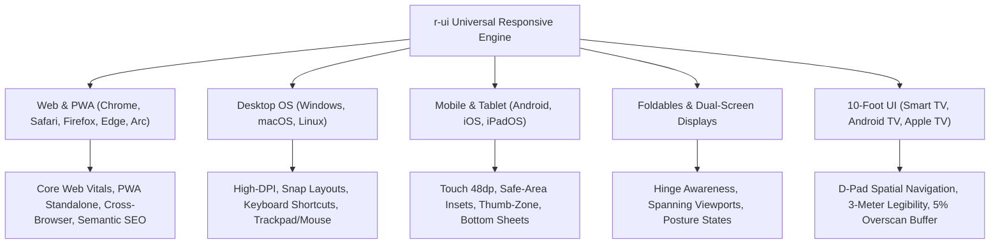

# r-ui: Universal UI/UX Design System & Visual-First Architecture

`r-ui` adalah skill panduan operasional orisinal untuk merancang antarmuka (UI) dan pengalaman pengguna (UX) berskala produksi berestetika agensi papan atas: **Visual-First**, **Padat & Ringkas (Anti-Wall-of-Text)**, **Bebas dari Shadow Keruh/Pekat**, **Bebas dari Efek Neon & Cyberpunk**, **Adaptif terhadap DNA Proyek**, dan **Bebas Risiko HAKI** (100% menggunakan namespace orisinal `--r-ui-*`).

---

## 1. THE 10 ANTI-SLOP VISUAL LAWS (Non-Negotiable)

```text
┌─────────────────────────────────────────────────────────────────────────────┐
│                       THE 10 ANTI-SLOP DESIGN LAWS                          │
├─────────────────────────────────────────────────────────────────────────────┤
│  1. BAN THE PURPLE HAZE     ──► No generic AI-purple/pink mesh gradients    │
│  2. BAN SYMMETRIC BENTO     ──► Asymmetric weights & hierarchy (2:1 spans)  │
│  3. BAN INTER MONOCULTURE   ──► Distinctive display + refined body font     │
│  4. BAN GLASS OVERDOSE      ──► Max blur 6-8px, crisp 1px borders only      │
│  5. BAN POINTLESS MOTION    ──► Purposeful haptic springs, no loop spin     │
│  6. BAN MOCK DATA VAGUENESS ──► Realistic domain data, zero "Lorem Ipsum"   │
│  7. BAN HEAVY MUDDY SHADOWS ──► Zero thick black blur; crisp micro-elevate  │
│  8. BAN NEON & CYBERPUNK    ──► Calibrated optical tones; zero glow rings   │
│  9. BAN RAW NATIVE FORMS    ──► Zero unstyled <select>; 100% componentized  │
│ 10. BAN COLOR HIJACKING     ──► Honor existing color system; zero rogue hex │
└─────────────────────────────────────────────────────────────────────────────┘
```

---

## 2. THE 5 GOLDEN DESIGN REFERENCES (Curated Standards)

Selalu jadikan 5 referensi terkurasi berikut sebagai standar rujukan utama:

| Pilar Referensi | Sumber Rujukan | Area Fokus Utama |
|:---|:---|:---|
| **1. Modern Components & Bento** | **[jiro.build](https://jiro.build)** *(MCP `jiro`)* | 1,400+ desain komponen produksi, blok bento asimetris, kartu interaktif, pricing tables. |
| **2. Delight & Micro-interactions** | **[designspells.com](https://designspells.com)** | Micro-interactions taktil, fisika pegas (*fluid spring physics*), feedback hover presisi. |
| **3. Audited Type & Color Systems** | **[styles.refero.design](https://styles.refero.design)** | Sistem warna nyata produk digital dunia, pasangan tipografi display vs body teruji. |
| **4. High-Impact Hero Layouts** | **[supahero.io](https://supahero.io)** | Arsitektur hero section bertenaga tinggi, visual value proposition, header navigation. |
| **5. Real App Flows & Journeys** | **[mobbin.com](https://mobbin.com)** *(MCP `mobbin`)* | Alur onboarding, drawer navigation, dialog transitions, dan empty state nyata. |

---

## 3. PROJECT DNA ADAPTATION & VISUAL DIALS

`r-ui` menolak desain kaku (*anti-rigid*). Kalibrasikan 4 dial visual sebelum merancang komponen:

```text
┌─────────────────────────────────────────────────────────────────────────────┐
│                      THE 4 r-ui ADAPTIVE PROJECT DIALS                      │
├─────────────────────────────────────────────────────────────────────────────┤
│  1. VISUAL DENSITY    ──► 1 (Airy / Luxury)  ◄──────► 10 (Compact Cockpit)  │
│  2. CORNER RADIUS     ──► 0px (Sharp Brutal) ◄──────► 9999px (Pill Playful) │
│  3. MOTION INTENSITY  ──► 1 (Static Calm)    ◄──────► 10 (Cinematic Spring) │
│  4. CONTRAST LEVEL    ──► Subtle / Muted     ◄──────► High Contrast AAA     │
└─────────────────────────────────────────────────────────────────────────────┘
```

### 5 Arketipe Proyek Inti:
1. **High-Density B2B Cockpit** *(Trading, ERP, CRM, Analytics)*: Density 8–9, Radius 4px, Motion 1–2 (Padding kompak 8–12px, font 13–14px, kecepatan input maksimal).
2. **Consumer Playful / Lifestyle** *(E-Commerce, Social, EdTech)*: Density 4–5, Radius 12–16px, Motion 7–8 (Spasi lega 24–32px, micro-border halus, haptic spring).
3. **Minimalist Swiss / Editorial** *(Portfolio, Agency, Publishing)*: Density 3–4, Radius 0px–2px, Motion 2–3 (Ruang negatif luas, border 1px tegas, kontras tipe tinggi).
4. **Minimalist Precision Dark Tech** *(DevTools, AI Workbenches, Cloud)*: Density 7–8, Radius 4px–6px, Motion 3–4 (Kanvas gelap pekat `#0b0f19`, teks tajam `#f9fafb`, zero-neon).
5. **Regulated & Public Sector** *(Layanan Publik, Medis, Legal)*: Density 5–6, Radius 6px–8px, Motion 1–2 (Target sentuh 48px, WCAG AAA, zero-transparency).

*Panduan lengkap:* [r-ui-project-adapter.md](references/r-ui-project-adapter.md) dan [r-ui-config-schema.json](references/r-ui-config-schema.json).

---

## 4. UNIVERSAL MULTI-DEVICE & CROSS-PLATFORM MATRIX



*Panduan lengkap resep:* [r-ui-responsive-matrix.md](references/r-ui-responsive-matrix.md).

---

## 5. DUAL-LAYER THEME SYSTEM (CANVAS + COLOR THEMES)

```html
<!-- Contoh Kombinasi Bebas -->
<html data-r-ui-theme="dark-nebula" data-r-ui-accent="emerald">
<!-- Atau Slate Obsidian dengan Aksen Crimson -->
<html data-r-ui-theme="slate-obsidian" data-r-ui-accent="crimson">
```

- **5 Canvas Themes**: `dark-nebula` (Dark Tech), `clean-light` (Warm Light), `slate-obsidian` (High-End Dark), `warm-sepia` (Editorial Paper), `high-contrast` (WCAG AAA).
- **8 Calibrated Color Accents**: `cyan`, `emerald`, `violet`, `crimson`, `amber`, `monochrome`, `frost`, `coral` (Semua terkalibrasi optik, zero-neon).

*Spesifikasi warna:* [r-ui-color-themes.css](references/r-ui-color-themes.css) dan [r-ui-themes.css](references/r-ui-themes.css).

---

## 6. MODULAR CODE DELIVERABLES

- 🏛️ **Master Blueprint Dashboard Kit (9 Pilar & 45+ Komponen)**: [r-ui-dashboard-kit-spec.md](references/r-ui-dashboard-kit-spec.md)
- 📜 **Boilerplate Kontrak Tipe TS**: [r-ui-contract-types.ts](references/r-ui-contract-types.ts)
- 📦 **Compound Components (`unstyled?: boolean`)**: [r-ui-compound-components.tsx](references/r-ui-compound-components.tsx)
- 🎛️ **Widget Pemilih Tema & Aksen Interaktif**: [r-ui-theme-switcher.tsx](references/r-ui-theme-switcher.tsx)
- ⚙️ **Adapter Multi-Framework (React, Tailwind, Vue, Svelte, Ink)**: [r-ui-framework-adapters.md](references/r-ui-framework-adapters.md)
- 🏛️ **Tata Kelola Arsitektur Modular Atomik**: [r-ui-modular-architecture.md](references/r-ui-modular-architecture.md)
- 🎮 **Interactive Live Showcase**: [r-ui-showcase.html](references/examples/r-ui-showcase.html)

---

## 7. COMPLETE TECHNICAL REFERENCES

- 🏛️ **Spesifikasi Lengkap Dashboard Kit**: [r-ui-dashboard-kit-spec.md](references/r-ui-dashboard-kit-spec.md)
- 🎨 **Token Desain Standar**: [r-ui-tokens.css](references/r-ui-tokens.css)
- 📐 **Spesifikasi Komponen Visual**: [r-ui-component-specs.md](references/r-ui-component-specs.md)
- 📱 **Panduan Responsif Multi-Device**: [r-ui-responsive-matrix.md](references/r-ui-responsive-matrix.md)
- 🕹️ **Dokumentasi Contoh Playground**: [README.md](references/examples/README.md)

---

## 8. PRE-FLIGHT UI/UX AUDIT CHECKLIST (19-Point Gate)

```text
[ ] 1.  Anti-Slop Check: Bebas dari AI-purple mesh gradient, bento seragam, & teks dummy "Lorem".
[ ] 2.  Anti-Neon Check: Bebas dari warna fluorescent menusuk mata dan efek glowing box-shadow.
[ ] 3.  Anti-Heavy Shadow Check: Bebas dari shadow keruh hitam tebal; gunakan micro-elevation 1-3px.
[ ] 4.  Visual Density: Teks penjelasan padat & ringkas, hierarki visual kuat, spasi 4pt/8pt.
[ ] 5.  Project DNA Match: Dials (Density, Radius, Motion, Contrast) sesuai arketipe proyek.
[ ] 6.  HAKI Compliance: Seluruh token baku dan kelas CSS menggunakan prefix orisinal --r-ui-*.
[ ] 7.  Mobile Ergonomics: Target sentuh min 44x44px, bottom-sheet di layar kecil, safe-area-inset.
[ ] 8.  Desktop Multi-Window: Fractional DPI crisp scaling, hotkeys navigasi jelas.
[ ] 9.  10-Foot UI (TV): D-Pad spatial navigation (Arrow keys), perbesaran 1.08x, outline kontras.
[ ] 10. Contrast Ratio: Lolos WCAG 2.2 AA (min 4.5:1 untuk teks normal, 3:1 teks besar).
[ ] 11. Dual-Layer Theming: Elemen merespons pergantian data-r-ui-theme dan data-r-ui-accent.
[ ] 12. Fluid Typography: Menggunakan clamp() proporsional, tanpa layout break saat di-zoom.
[ ] 13. Spring Motion: Menggunakan kurva spring cubic-bezier(0.16, 1, 0.3, 1), durasi 180-260ms.
[ ] 14. Modality Awareness: Komponen membedakan input sentuh (touch) vs mouse presisi.
[ ] 15. Unstyled Flexibility: Mendukung mode unstyled?: boolean untuk styling bebas.
[ ] 16. Zero-Dependency: Tidak ada library eksternal wajib yang dipaksakan.
[ ] 17. Componentized Form Check: 100% bebas dari elemen raw native <select>, checkbox, atau radio; seluruhnya menggunakan r-ui Custom Form Components.
[ ] 18. Dashboard Completeness Gate: Meliputi ke-9 pilar arsitektur dashboard kit (Shell, Telemetri, Data Table, Visualisasi, Form kustom, Overlay, Navigasi, Identitas, dan Konsol DevOps).
[ ] 19. Existing Color & Theme Conformance: Telah melakukan audit sistem warna eksisting dan memastikan 100% elemen baru/modifikasi tunduk pada CSS variables, tokens, dan tema yang sudah ada (zero rogue hardcoded hex/rgb).
```

---

## 9. STRICT COMPONENTIZED FORM POLICY (Zero Raw Native Forms)

Agen **DILARANG KERAS** menggunakan elemen form HTML mentah bawaan browser (*raw native unstyled form elements*), terutama elemen native `<select>` dan `<option>`.

### Mengapa Native `<select>` Dilarang?
- Menu popup `<option>` bawaan sistem operasi (Windows Win32, macOS popup) tidak mematuhi CSS variables, merusak mode gelap (*dark canvas*), tidak dapat disesuaikan tipografinya, dan merusak keselarasan visual antarmuka.
- Dropdown native tidak mendukung *search filtering*, *multi-select chips*, *custom icons*, maupun animasi transisi spring.

### Standar Wajib: r-ui Custom Accessible Form Components
Setiap form pemilihan wajib menggunakan **r-ui Custom Select Component**:
- **Trigger Button**: Memiliki label aktif, ikon status, dan custom chevron SVG yang berputar halus saat dibuka.
- **Floating Popover Menu**: Permukaan mengambang dengan micro-elevation tajam (`--r-ui-shadow-lg`), border 1px halus, dan latar yang sepenuhnya selaras dengan tema kanvas aktif.
- **Searchable / Filterable**: Mendukung penyaringan opsi secara instan saat opsi berjumlah > 5.
- **Full Keyboard Navigation**: Mendukung navigasi panah (`ArrowUp` / `ArrowDown`), pemilihan via `Enter` / `Space`, dan penutupan via `Escape`.
- **W3C ARIA Accessible**: Menggunakan atribut `role="listbox"`, `role="option"`, `aria-expanded`, dan `aria-selected`.

---

## 10. MANDATORY 9-PILLAR (45+ COMPONENT) ARCHITECTURE FOR DASHBOARD KITS

Setiap kali diminta membuat Dashboard Kit atau UI Kit dengan `r-ui`, agen **WAJIB MENYEDIAKAN SUITE LENGKAP 9 PILAR (45+ KOMPONEN)**, tidak boleh hanya layout monitoring/cockpit parsial:

1. **Pilar 1 — Shell & Navigation**: Collapsible Sidebar (Expanded 240px & Mini-Rail 60px), Workspace/Org Switcher, Top Header, Breadcrumb Trail, Page Action Toolbar, Master-Detail Inspector Drawer.
2. **Pilar 2 — Metrics & Telemetry**: High-Density Stat Cards (Value, Delta %, Context Subtitle), Architectural Telemetry Ribbon (Anti-Card Overuse), Segmented Quota Gauges, 90-Day Uptime Strip & Live Latency Pulse Dot.
3. **Pilar 3 — Data Tables & Collections**: High-Density Data Grid, Sortable Headers, Custom Row Checkbox (Indeterminate Support), Floating Bulk Action Bar, Pagination & Page Size Selector, Faceted Filter Popovers & Active Filter Chips, Empty States, Skeleton Shimmer.
4. **Pilar 4 — Data Visualization**: Time-Series Area Curves dengan interactive crosshair, Grouped/Stacked Bar Charts, Donut Distribution dengan center aggregate & legend, Latency Histogram, Interactive Chart Tooltips.
5. **Pilar 5 — Form & Inputs (Zero Native Forms)**: Custom Accessible Select (Searchable, Popover), Multi-Select with Removable Chips, Date & Date-Range Picker, Prefix/Suffix Inputs, Number Steppers, Textarea with Counter, Tactile Spring Switch, Custom Checkbox & Radio Cards, Dual-Thumb Range Slider, Drag-and-Drop Dropzone.
6. **Pilar 6 — Feedback, Overlays & Drawers**: Modal Dialogs dengan backdrop blur, Slide-Over Sheet / Inspector Drawer kanan, Slide-in Toast Stack (Success/Error/Warning/Info/Undo), Alert Banners, Destructive Confirmation Dialog, Tooltips mikro, Context Menu Popover.
7. **Pilar 7 — Navigation & Wayfinding**: Command Palette (`Ctrl+K` / `⌘+K`) dengan fuzzy search, Segmented Controls, Line/Pill Tabs, Stepper / Multi-Step Wizard, Tree Views.
8. **Pilar 8 — Identity, Display & Content**: Avatars & Stacked Avatar Groups dengan online presence dot, Status Badges dengan animasi pulse dot, Activity Timeline / Audit Feed, Key-Value Metadata Grid, Code Snippet & JSON Inspector.
9. **Pilar 9 — Real-Time & DevOps Consoles**: Live Streaming Monospace Terminal Console (INFO/WARN/ERR/DEBUG, auto-scroll lock, log search), Secret Masking Env Var Editor, Latency Ping Meter.
10. **Interactive Component Showcase**: Wajib menyertakan tab/halaman katalog interaktif di mana seluruh komponen dari ke-9 pilar dapat diuji fungsionalitas dan respon temanya secara live.

*Spesifikasi teknis & blueprint lengkap:* [r-ui-dashboard-kit-spec.md](references/r-ui-dashboard-kit-spec.md).

---

## 11. MANDATORY EXISTING COLOR & THEME CONFORMANCE PROTOCOL

Setiap kali agen membuat komponen baru, merefaktor kode, atau memodifikasi antarmuka di proyek yang sudah ada, agen **WAJIB MEMATUHI PROTOKOL 4 LANGKAH INI SEBELUM MEMULAI CODING**:

```text
┌─────────────────────────────────────────────────────────────────────────────┐
│             EXISTING COLOR & THEME CONFORMANCE WORKFLOW                     │
├─────────────────────────────────────────────────────────────────────────────┤
│ 1. DISCOVERY & MAPPING ──► Audit :root, tokens, CSS vars, & active themes   │
│ 2. ZERO ROGUE COLORS   ──► Ban hardcoded hex/rgb; 100% map to existing vars │
│ 3. THEME REACTIVITY    ──► Ensure dynamic adaptation to dark/light/accents  │
│ 4. FORMAL EXTENSION    ──► Derive only from existing ramps (50-950 / alpha) │
└─────────────────────────────────────────────────────────────────────────────┘
```

### Langkah 1: Audit Sistem Warna & Tema Eksisting (Pre-Flight Inspection)
Sebelum menulis satu baris pun CSS atau styling:
1. **Telusuri Berkas Token & Styling**: Periksa `:root`, `tokens.css`, `themes.css`, `globals.css`, `tailwind.config`, atau atribut HTML seperti `data-theme`, `data-r-ui-theme`, `data-r-ui-accent`.
2. **Petakan Peran Semantik (Semantic Roles)**:
   - **Kanvas & Permukaan**: Cari token background dasar (misal `--r-ui-color-canvas`, `--r-ui-color-surface`, `--r-ui-color-surface-elevated`).
   - **Batas & Hairlines**: Cari token border (misal `--r-ui-color-border-standard`, `--r-ui-color-border-subtle`).
   - **Hierarki Teks**: Cari token tipografi (misal `--r-ui-color-text-primary`, `--r-ui-color-text-secondary`, `--r-ui-color-text-tertiary`).
   - **Aksen & State Interaktif**: Cari token brand/aksen (misal `--r-ui-color-accent-primary`, `--r-ui-color-focus-ring`, `--r-ui-color-success`, `--r-ui-color-error`).

### Langkah 2: Dilarang Keras Memasukkan Hex/RGB Liar (Zero Rogue Hardcoded Colors)
- **Hukum Mutlak**: Agen **DILARANG KERAS** menuliskan warna hardcoded sembarangan seperti `background: #1e293b; color: #64748b;` jika proyek sudah memiliki sistem CSS variables seperti `var(--r-ui-color-surface-elevated)` atau `var(--r-ui-color-text-secondary)`.
- Seluruh elemen baru atau modifikasi **100% WAJIB MEMAKAI CSS VARIABLES / DESIGN TOKENS EKSISTING**.
- Pelanggaran terhadap sistem warna eksisting dianggap sebagai **SLOP & DESAIN INKONSISTEN**.

### Langkah 3: Pengujian Reaktivitas Multi-Tema (Theme-Reactivity)
- Seluruh elemen yang dimodifikasi atau baru ditambahkan wajib diuji terhadap perubahan tema aktif (misal dari mode Dark Nebula ke Clean Light atau Slate Obsidian).
- Tidak boleh ada elemen dengan warna teks/background statis yang menjadi tidak terbaca (*contrast broken*) saat pengguna berpindah tema.

### Langkah 4: Protokol Ekstensi Warna Terkendali
- Jika sebuah komponen membutuhkan transparansi atau variasi warna yang belum tersedia, **DILARANG** mengarang warna baru.
- Gunakan fungsi `rgba()` berbasis token aksen yang ada (misal `rgba(var(--r-ui-color-accent-primary-rgb), 0.15)`) atau gunakan skala ramp terdaftar (`--r-ui-color-accent-50` hingga `950`).
- Jika penambahan token permanen memang diperlukan, daftarkan token tersebut secara formal di file token utama proyek terlebih dahulu dengan persetujuan hierarki desain.


