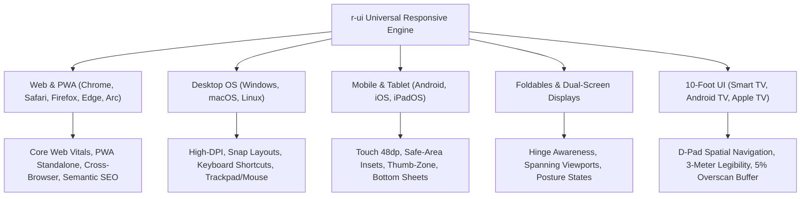

# r-ui: Universal UI/UX Design System & Visual-First Architecture

`r-ui` adalah skill panduan operasional orisinal untuk merancang antarmuka (UI) dan pengalaman pengguna (UX) berskala produksi berestetika agensi papan atas: **Visual-First**, **Padat & Ringkas (Anti-Wall-of-Text)**, **Bebas dari Shadow Keruh/Pekat**, **Bebas dari Efek Neon & Cyberpunk**, **Adaptif terhadap DNA Proyek**, dan **Bebas Risiko HAKI** (100% menggunakan namespace orisinal `--r-ui-*`).

---

## 1. THE 8 ANTI-SLOP VISUAL LAWS (Non-Negotiable)

```text
┌─────────────────────────────────────────────────────────────────────────────┐
│                       THE 8 ANTI-SLOP DESIGN LAWS                           │
├─────────────────────────────────────────────────────────────────────────────┤
│  1. BAN THE PURPLE HAZE     ──► No generic AI-purple/pink mesh gradients    │
│  2. BAN SYMMETRIC BENTO     ──► Asymmetric weights & hierarchy (2:1 spans)  │
│  3. BAN INTER MONOCULTURE   ──► Distinctive display + refined body font     │
│  4. BAN GLASS OVERDOSE      ──► Max blur 6-8px, crisp 1px borders only      │
│  5. BAN POINTLESS MOTION    ──► Purposeful haptic springs, no loop spin     │
│  6. BAN MOCK DATA VAGUENESS ──► Realistic domain data, zero "Lorem Ipsum"   │
│  7. BAN HEAVY MUDDY SHADOWS ──► Zero thick black blur; crisp micro-elevate  │
│  8. BAN NEON & CYBERPUNK    ──► Calibrated optical tones; zero glow rings   │
└─────────────────────────────────────────────────────────────────────────────┘
```

---

## 2. THE 5 GOLDEN DESIGN REFERENCES (Curated Standards)

Selalu jadikan 5 referensi terkurasi berikut sebagai standar rujukan utama:

| Pilar Referensi | Sumber Rujukan | Area Fokus Utama |
|:---|:---|:---|
| **1. Modern Components & Bento** | **[jiro.build](https://jiro.build)** *(MCP `jiro`)* | 1,400+ desain komponen produksi, blok bento asimetris, kartu interaktif, pricing tables. |
| **2. Delight & Micro-interactions** | **[designspells.com](https://designspells.com)** | Micro-interactions taktil, fisika pegas (*fluid spring physics*), feedback hover presisi. |
| **3. Audited Type & Color Systems** | **[styles.refero.design](https://styles.refero.design)** | Sistem warna nyata produk digital dunia, pasangan tipografi display vs body teruji. |
| **4. High-Impact Hero Layouts** | **[supahero.io](https://supahero.io)** | Arsitektur hero section bertenaga tinggi, visual value proposition, header navigation. |
| **5. Real App Flows & Journeys** | **[mobbin.com](https://mobbin.com)** *(MCP `mobbin`)* | Alur onboarding, drawer navigation, dialog transitions, dan empty state nyata. |

---

## 3. PROJECT DNA ADAPTATION & VISUAL DIALS

`r-ui` menolak desain kaku (*anti-rigid*). Kalibrasikan 4 dial visual sebelum merancang komponen:

```text
┌─────────────────────────────────────────────────────────────────────────────┐
│                      THE 4 r-ui ADAPTIVE PROJECT DIALS                      │
├─────────────────────────────────────────────────────────────────────────────┤
│  1. VISUAL DENSITY    ──► 1 (Airy / Luxury)  ◄──────► 10 (Compact Cockpit)  │
│  2. CORNER RADIUS     ──► 0px (Sharp Brutal) ◄──────► 9999px (Pill Playful) │
│  3. MOTION INTENSITY  ──► 1 (Static Calm)    ◄──────► 10 (Cinematic Spring) │
│  4. CONTRAST LEVEL    ──► Subtle / Muted     ◄──────► High Contrast AAA     │
└─────────────────────────────────────────────────────────────────────────────┘
```

### 5 Arketipe Proyek Inti:
1. **High-Density B2B Cockpit** *(Trading, ERP, CRM, Analytics)*: Density 8–9, Radius 4px, Motion 1–2 (Padding kompak 8–12px, font 13–14px, kecepatan input maksimal).
2. **Consumer Playful / Lifestyle** *(E-Commerce, Social, EdTech)*: Density 4–5, Radius 12–16px, Motion 7–8 (Spasi lega 24–32px, micro-border halus, haptic spring).
3. **Minimalist Swiss / Editorial** *(Portfolio, Agency, Publishing)*: Density 3–4, Radius 0px–2px, Motion 2–3 (Ruang negatif luas, border 1px tegas, kontras tipe tinggi).
4. **Minimalist Precision Dark Tech** *(DevTools, AI Workbenches, Cloud)*: Density 7–8, Radius 4px–6px, Motion 3–4 (Kanvas gelap pekat `#0b0f19`, teks tajam `#f9fafb`, zero-neon).
5. **Regulated & Public Sector** *(Layanan Publik, Medis, Legal)*: Density 5–6, Radius 6px–8px, Motion 1–2 (Target sentuh 48px, WCAG AAA, zero-transparency).

*Panduan lengkap:* [r-ui-project-adapter.md](references/r-ui-project-adapter.md) dan [r-ui-config-schema.json](references/r-ui-config-schema.json).

---

## 4. UNIVERSAL MULTI-DEVICE & CROSS-PLATFORM MATRIX



*Panduan lengkap resep:* [r-ui-responsive-matrix.md](references/r-ui-responsive-matrix.md).

---

## 5. DUAL-LAYER THEME SYSTEM (CANVAS + COLOR THEMES)

```html
<!-- Contoh Kombinasi Bebas -->
<html data-r-ui-theme="dark-nebula" data-r-ui-accent="emerald">
<!-- Atau Slate Obsidian dengan Aksen Crimson -->
<html data-r-ui-theme="slate-obsidian" data-r-ui-accent="crimson">
```

- **5 Canvas Themes**: `dark-nebula` (Dark Tech), `clean-light` (Warm Light), `slate-obsidian` (High-End Dark), `warm-sepia` (Editorial Paper), `high-contrast` (WCAG AAA).
- **8 Calibrated Color Accents**: `cyan`, `emerald`, `violet`, `crimson`, `amber`, `monochrome`, `frost`, `coral` (Semua terkalibrasi optik, zero-neon).

*Spesifikasi warna:* [r-ui-color-themes.css](references/r-ui-color-themes.css) dan [r-ui-themes.css](references/r-ui-themes.css).

---

## 6. MODULAR CODE DELIVERABLES

- 📜 **Boilerplate Kontrak Tipe TS**: [r-ui-contract-types.ts](references/r-ui-contract-types.ts)
- 📦 **Compound Components (`unstyled?: boolean`)**: [r-ui-compound-components.tsx](references/r-ui-compound-components.tsx)
- 🎛️ **Widget Pemilih Tema & Aksen Interaktif**: [r-ui-theme-switcher.tsx](references/r-ui-theme-switcher.tsx)
- ⚙️ **Adapter Multi-Framework (React, Tailwind, Vue, Svelte, Ink)**: [r-ui-framework-adapters.md](references/r-ui-framework-adapters.md)
- 🏛️ **Tata Kelola Arsitektur Modular Atomik**: [r-ui-modular-architecture.md](references/r-ui-modular-architecture.md)
- 🎮 **Interactive Live Showcase**: [r-ui-showcase.html](references/examples/r-ui-showcase.html)

---

## 7. COMPLETE TECHNICAL REFERENCES

- 🎨 **Token Desain Standar**: [r-ui-tokens.css](references/r-ui-tokens.css)
- 📐 **Spesifikasi Komponen Visual**: [r-ui-component-specs.md](references/r-ui-component-specs.md)
- 📱 **Panduan Responsif Multi-Device**: [r-ui-responsive-matrix.md](references/r-ui-responsive-matrix.md)
- 🕹️ **Dokumentasi Contoh Playground**: [README.md](references/examples/README.md)

---

## 8. PRE-FLIGHT UI/UX AUDIT CHECKLIST (16-Point Gate)

```text
[ ] 1.  Anti-Slop Check: Bebas dari AI-purple mesh gradient, bento seragam, & teks dummy "Lorem".
[ ] 2.  Anti-Neon Check: Bebas dari warna fluorescent menusuk mata dan efek glowing box-shadow.
[ ] 3.  Anti-Heavy Shadow Check: Bebas dari shadow keruh hitam tebal; gunakan micro-elevation 1-3px.
[ ] 4.  Visual Density: Teks penjelasan padat & ringkas, hierarki visual kuat, spasi 4pt/8pt.
[ ] 5.  Project DNA Match: Dials (Density, Radius, Motion, Contrast) sesuai arketipe proyek.
[ ] 6.  HAKI Compliance: Seluruh token baku dan kelas CSS menggunakan prefix orisinal --r-ui-*.
[ ] 7.  Mobile Ergonomics: Target sentuh min 44x44px, bottom-sheet di layar kecil, safe-area-inset.
[ ] 8.  Desktop Multi-Window: Fractional DPI crisp scaling, hotkeys navigasi jelas.
[ ] 9.  10-Foot UI (TV): D-Pad spatial navigation (Arrow keys), perbesaran 1.08x, outline kontras.
[ ] 10. Contrast Ratio: Lolos WCAG 2.2 AA (min 4.5:1 untuk teks normal, 3:1 teks besar).
[ ] 11. Dual-Layer Theming: Elemen merespons pergantian data-r-ui-theme dan data-r-ui-accent.
[ ] 12. Fluid Typography: Menggunakan clamp() proporsional, tanpa layout break saat di-zoom.
[ ] 13. Spring Motion: Menggunakan kurva spring cubic-bezier(0.16, 1, 0.3, 1), durasi 180-260ms.
[ ] 14. Modality Awareness: Komponen membedakan input sentuh (touch) vs mouse presisi.
[ ] 15. Unstyled Flexibility: Mendukung mode unstyled?: boolean untuk styling bebas.
[ ] 16. Zero-Dependency: Tidak ada library eksternal wajib yang dipaksakan.
```
