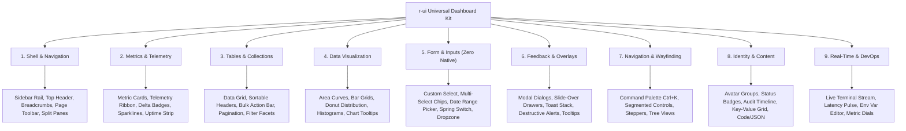

# r-ui Universal Dashboard Kit Architecture Specification (v2.2.0)

> **The Definitive Industry Blueprint for High-Agency, Production-Grade Analytical Consoles & SaaS Dashboards**  
> Built upon the **9 Anti-Slop Visual Laws**, **Dual-Layer Theming**, **Dashboard Hardening**, and **Strict Componentized Form Policy**.

---

## 🏛️ Executive Summary & Design Philosophy

Dashboard modern bukanlah sekadar kumpulan kartu metrik acak dengan gradasi ungu generic (*slop*). Dashboard kelas dunia (seperti pada Stripe, Vercel, Supabase, Linear, Cloudflare, dan Datadog) mengutamakan:
1. **High Visual Density & Information Hierarchy**: Tata letak berorientasi data (*data-dense*), menggunakan micro-elevation (1–3px) dan hairline borders (1px), bukan shadow hitam pekat.
2. **Dashboard Hardening (Anti-Card Overuse)**: Menggabungkan metrik ke dalam **Architectural Telemetry Ribbons** dan pembagi vertikal bergaris tipis tanpa mengurung setiap angka ke dalam kotak terpisah.
3. **Zero Raw Native Forms**: 100% komponen form (terutama Select, Multi-Select, Checkbox, Toggle) menggunakan custom accessible DOM popovers yang mematuhi token tema dan WCAG 2.2 AA.
4. **Actionable Workflows**: Data table dilengkapi pencarian instan, filter facet, aksi massal (*bulk actions*), pagination responsif, dan slide-over inspector drawer.

---

## 🧩 The 9 Architectural Pillars (45+ Component Taxonomy)



---

## PILLAR 1: SHELL & NAVIGATION ARCHITECTURE

Struktur kerangka dasar antarmuka aplikasi berskala enterprise.

### 1.1 Collapsible Sidebar Navigation (`.r-ui-sidebar`)
- **Expanded State (240px–260px)**: Menampilkan logo sistem, workspace switcher, kategori menu (`.r-ui-nav-group-title`), link navigasi dengan leading icon, label teks, dan trailing badge counter.
- **Mini Rail State (56px–64px)**: Mode ramping hemat ruang untuk perangkat tablet/desktop sekunder; hanya menampilkan ikon dengan floating tooltip saat hover.
- **Organization / Workspace Switcher**: Dropdown popover di bagian atas sidebar untuk berpindah organisasi/proyek dengan status dot aktif.
- **User Profile Pill**: Di dasar sidebar, menampilkan avatar, nama user, role (`Admin`), dan tombol popover status.

### 1.2 App Navigation Header (`.r-ui-header`)
- **Breadcrumb Trail**: Jalur navigasi dinamis (`Infrastruktur / Kluster Edge / US-East-1`) dengan pemisah slash tipis dan auto-truncation pada layar sempit.
- **Command Palette Trigger Button**: Input semu atau tombol pintas (`Ctrl + K` / `⌘ + K`) dengan badge kustom.
- **Environment & Branch Selector**: Indikator pill lingkungan aktif (misal `production • main` vs `staging • pr-42`).
- **Action Group**: Notification Center trigger dengan pulsating badge dot untuk unread alert, Help/Docs button, dan Theme/Accent Switcher.

### 1.3 Page Header & Action Hero Bar (`.r-ui-page-header`)
- **Header Metadata**: Title (h1, semi-bold 1.25rem), status tag (`Healthy`), dan subtitle deskriptif singkat.
- **Action Toolbar**: Date-Range Picker popover, tombol Filter, tombol Export data (`CSV/JSON`), dan tombol aksi utama (`+ New Deployment`).

### 1.4 Master-Detail Splitter & Right Inspector Drawer
- Membagi layar kerja menjadi daftar entitas utama dan panel inspeksi cepat di sisi kanan tanpa harus memuat ulang halaman (*zero context loss*).

---

## PILLAR 2: METRICS & TELEMETRY DISPLAYS

Visualisasi KPI utama yang padat, bebas dari isolasi card yang berlebihan.

### 2.1 Metric / Stat Card (`.r-ui-stat-card`)
- **Label**: Tipografi kecil (0.75rem), warna sekunder dengan ikon bantuan atau info tooltip.
- **Big Value**: Angka metrik berukuran tebal (1.5rem–1.75rem) dengan formatting angka lokal (misal: `$148,290.00`, `99.99%`, `14.2 ms`).
- **Delta Trend Badge**: Badge kenaikan/penurunan persentase (`+14.8% ↑` hijau untuk revenue/positif, `-3.2% ↓` merah untuk penurunan performa/error).
- **Comparison Context**: Micro-text perbandingan ("vs 30 hari sebelumnya").
- **Mini Sparkline**: Grafik tren micro SVG tertanam di bagian bawah kartu.

### 2.2 Architectural Telemetry Ribbon (`.r-ui-telemetry-ribbon`)
- Strip metrik horizontal satu baris yang menyatukan 4–6 metrik tanpa kotak kartu terpisah.
- Dibatasi oleh hairline divider 1px vertikal (`--r-ui-color-border-standard`).
- Menghemat ruang vertikal secara drastis (*high agency density*).

### 2.3 Progress & Quota Gauges (`.r-ui-gauge-bar`, `.r-ui-radial-gauge`)
- **Segmented Bar**: Menampilkan kuota penggunaan kapasitas (misal: Storage 72/100 GB) dengan transisi mulus.
- **Radial Donut Meter**: Menampilkan persentase performa beban CPU / RAM dengan indikator warna status optik.

### 2.4 Uptime & Latency Pulse Strip (`.r-ui-uptime-strip`)
- Deretan 90 balok micro-bar yang mewakili ketersediaan sistem selama 90 hari terakhir.
- Warna hijau untuk operasional normal, kuning untuk insiden minor, merah untuk downtime.
- Dilengkapi dengan ping latensi real-time beranimasi pulse dot (`14ms Ping`).

---

## PILLAR 3: DATA TABLES & COLLECTIONS (CORE WORKHORSE)

Pusat kendali dan manajemen data utama pada dashboard.

### 3.1 High-Density Data Grid (`.r-ui-table`)
- **Sortable Header**: Kolom dengan header klik untuk sort asc/desc/neutral disertai ikon panah halus.
- **Row Selection**: Checkbox kustom di setiap baris dan di header dengan dukungan status *indeterminate* ("Select All").
- **Hover & Selected States**: Baris berubah warna lembut saat di-hover dan mendapat aksen outline tipis saat dipilih.
- **Monospace Numerical Alignment**: Kolom angka (harga, latensi, persentase) wajib menggunakan font monospaced rata kanan (`text-align: right; font-family: var(--r-ui-font-family-mono);`).
- **Action Kebab Menu**: Dropdown popover aksi baris (`...`) berisi Edit, View Logs, Clone, Delete.
- **Expandable Rows**: Baris yang dapat dibuka untuk melihat detail sub-entitas atau JSON trace.

### 3.2 Faceted Filter Bar & Active Filter Chips (`.r-ui-filter-bar`)
- **Search Input**: Input pencarian real-time dengan tombol clear (`×`) dan icon pencarian.
- **Facet Filter Popovers**: Tombol filter berbasis kategori (Status, Role, Wilayah) yang membuka menu checkbox popover.
- **Active Chips Strip**: Menampilkan filter aktif dalam bentuk chip mini yang dapat dihapus per satuan atau sekaligus (*Clear all*).
- **Preset Views / View Switcher**: Tab bar segmen cepat: *"All (1,240)"*, *"Active (890)"*, *"Suspended (42)"*, *"Requires Attention (5)"*.

### 3.3 Bulk Action Bar (`.r-ui-bulk-bar`)
- Bar aksi mengambang (*floating dock*) di bagian bawah layar yang muncul otomatis saat `> 0` baris dipilih.
- Menampilkan counter: *"3 entitas dipilih"*.
- Tombol aksi massal: *Export Selected*, *Tag*, *Suspend*, *Delete Selected*, dan tombol *Deselect All*.

### 3.4 Table Pagination & Page Size Controller (`.r-ui-pagination`)
- **Counter Info**: *"Menampilkan 1–25 dari 1,420 data"*.
- **Page Size Select**: Custom Select dropdown (`10`, `25`, `50`, `100` per halaman).
- **Navigation Buttons**: First, Prev, Nomor halaman aktif, Next, Last, serta input lompat halaman langsung.

### 3.5 Empty State & Skeleton Shimmer Loaders
- **Empty State**: Ikon vektor minimalis berlatar netral, judul jelas (*"Belum ada transaksi ditemukan"*), deskripsi solusi (*"Coba ubah filter pencarian Anda atau buat transaksi baru"*), dan tombol CTA aksi.
- **Skeleton Shimmer**: Baris tabel beranimasi shimmer berkas cahaya halus untuk menghindari layout shift saat data dimuat.

---

## PILLAR 4: DATA VISUALIZATION & ANALYTICS WIDGETS

Grafik berbasis SVG terintegrasi yang menghormati token palet tema kanvas dan aksen.

### 4.1 Time-Series Area & Line Charts (`.r-ui-chart-area`)
- Garis kurva Bezier halus dengan area gradien lembut beropasitas rendah di bawah kurva (maksimal 15% opacity).
- Interactive hover vertical ruler (crosshair tracker).
- Floating Tooltip Card yang mengikuti kursor mouse, menampilkan timestamp dan rincian angka tiap seri.

### 4.2 Grouped & Stacked Bar Charts (`.r-ui-chart-bar`)
- Batang vertikal atau horizontal dengan ujung atas membulat halus (radius 2–3px).
- Penanganan visual nilai negatif yang tegas di bawah garis batas nol.

### 4.3 Donut & Radial Distribution Charts (`.r-ui-chart-donut`)
- Cincin SVG dengan label tengah yang menampilkan nilai agregat utama (*"Total 100%"* atau *"4,821 Permintaan"*).
- Daftar legenda pill interaktif di samping atau di bawah grafik.

### 4.4 Latency Histogram & Real-Time Sparklines
- Distribusi latensi P50, P90, P99 dalam balok-balok proporsional.
- Micro-sparkline interaktif yang dapat disematkan di dalam sel tabel data.

---

## PILLAR 5: COMPONENTIZED FORM CONTROLS (ZERO NATIVE FORMS)

Sesuai **Hukum Desain ke-9 r-ui**: Seluruh elemen form wajib menggunakan komponen DOM kustom yang terisolasi dan aksesibel.

### 5.1 Custom Accessible Select (`.r-ui-custom-select`)
- Trigger button dengan label aktif, status icon, dan chevron SVG berputar.
- Floating popover menu yang selaras dengan tema kanvas aktif, micro-elevation, max-height scrollable, keyboard navigation, dan ARIA combobox/listbox attributes.

### 5.2 Multi-Select with Removable Chips (`.r-ui-multi-select`)
- Item terpilih langsung ditampilkan dalam bentuk tag chip kompak dengan tombol hapus (`×`) di dalam trigger.
- Popover menu dengan kolom pencarian instan, opsi "Pilih Semua", dan checkbox untuk tiap item.

### 5.3 Date & Date-Range Picker (`.r-ui-date-picker`)
- Preset range cepat: *"Hari Ini"*, *"7 Hari Terakhir"*, *"30 Hari Terakhir"*, *"Bulan Ini"*, *"Kustom"*.
- Kalender ganda popover untuk memilih rentang tanggal awal dan akhir dengan visual range highlight.

### 5.4 Text, Search & Number Inputs (`.r-ui-input`)
- Input dengan slot prefix (ikon / prefix mata uang) dan suffix (tombol clear, tombol copy, indikator satuan `ms`, `GB`).
- Number input dengan tombol stepper up/down berpresisi tinggi.
- Validasi state visual terpadu: `.is-error`, `.is-warning`, `.is-success` lengkap dengan pesan bantuan di bawah input.

### 5.5 Tactile Spring Switch, Checkbox & Radio Cards
- **Spring Switch**: Penggeser taktil dengan kurva pegas alami.
- **Custom Checkbox**: Kotak seleksi kustom dengan centang SVG halus dan status indeterminate.
- **Radio Cards**: Pilihan radio berbentuk kartu kontur dengan judul, deskripsi fitur, harga, dan radio ring terintegrasi.

### 5.6 Drag-and-Drop File Upload Zone (`.r-ui-dropzone`)
- Area dropzone bergaris putus-putus tipis (*dashed border*) dengan ikon upload, instruksi tipe berkas, dan batas ukuran maksimal.
- Daftar file terunggah dengan progress bar aktif, nama berkas, ukuran, dan tombol batalkan/hapus.

---

## PILLAR 6: FEEDBACK, MODALS & OVERLAYS

Mekanisme umpan balik kontekstual tanpa merusak alur fokus pengguna.

### 6.1 Modal Dialog (`.r-ui-modal`)
- Backdrop dengan efek blur halus (`backdrop-filter: blur(8px); background: rgba(0,0,0,0.6)`).
- Modal container dengan header jelas, tombol close silang (`Esc` hotkey), area konten scrollable, dan fixed action footer.
- Focus-trap otomatis untuk aksesibilitas keyboard.

### 6.2 Slide-Over Sheet / Inspector Drawer (`.r-ui-drawer`)
- Panel menggeser dari sisi kanan (lebar 420px–640px) untuk inspeksi rincian entitas tanpa berpindah URL.
- Memiliki header tersendiri, tab rincian internal, riwayat audit, dan tombol aksi cepat.

### 6.3 Slide-in Notification Toast Stack (`.r-ui-toast`)
- Kontainer tetap di pojok kanan bawah dengan tumpukan toast animasi pegas (*spring entrance*).
- Varian: Success (hijau), Error (merah), Warning (amber), Info (aksen tema).
- Dilengkapi dengan pesan ringkas, ikon status, tombol aksi (*"Undo"*), dan auto-dismiss timeout bar.

### 6.4 Destructive Confirmation Dialog
- Dialog pencegah kesalahan krusial (misal penghapusan basis data atau pembatalan instance produksi).
- Memerlukan input ketik nama entitas secara eksplisit sebelum tombol konfirmasi merah dapat diaktifkan.

### 6.5 Tooltips & Context Menus (`.r-ui-tooltip`, `.r-ui-popover`)
- Tooltip mikro dengan panah arah penunjuk (*directional arrow*) yang muncul instan pada hover/fokus keyboard.
- Context menu popover untuk klik kanan atau tombol tiga titik (`...`).

---

## PILLAR 7: NAVIGATION & WAYFINDING

Navigasi instan yang memungkinkan pengguna profesional berpindah konteks secepat kilat.

### 7.1 Command Palette (`Ctrl + K` / `⌘ + K`) (`.r-ui-command-palette`)
- Jendela pencarian global instan di tengah layar dengan backdrop blur.
- Fuzzy search yang mengelompokkan hasil ke dalam kategori: *Halaman Navigasi*, *Aksi Cepat*, *Pengaturan*, *Dokumentasi*.
- Navigasi penuh via tombol panah keyboard (`ArrowUp` / `ArrowDown`) dan eksekusi via `Enter`.

### 7.2 Segmented Control & Tabs (`.r-ui-segmented`, `.r-ui-tabs`)
- **Segmented Control**: Pengalih mode dengan latar surface elevated dan tombol aktif berbentuk kapsul mengambang dengan spring physics.
- **Line Tabs**: Tab bergaris bawah dengan indikator aktif yang bergeser dinamis.

### 7.3 Multi-Step Wizard / Stepper (`.r-ui-stepper`)
- Rangkaian proses bertahap (*Langkah 1 dari 4*) dengan ikon centang selesai, lingkaran langkah aktif, dan garis progres penghubung.

---

## PILLAR 8: IDENTITY, CONTENT & DISPLAY

Penyajian data atribut, identitas pengguna, dan format teknis.

### 8.1 Avatars & Stacked Avatar Groups (`.r-ui-avatar-group`)
- Avatar dengan foto atau inisial fallback berlatar aksen.
- Status dot kehadiran online/offline di pojok avatar.
- Stacked avatar group dengan tumpukan margin negatif dan badge sisa (*"+4"*).

### 8.2 Status Badges with Pulse Animation (`.r-ui-badge`)
- Badge semantik bertipografi monospaced dengan border halus dan latar pastel redup.
- Dilengkapi dengan *pulsing animated dot* untuk menandakan status live/aktif secara instan.

### 8.3 Activity Timeline & Audit Feed (`.r-ui-timeline`)
- Garis vertikal penghubung dengan node ikon status di setiap peristiwa.
- Menampilkan avatar pelaku, aksi perubahan (*"Deploy build #8942 ke production"*), badge commit hash, dan waktu relatif (*"4 menit yang lalu"*).

### 8.4 Key-Value / Description List (`.r-ui-kv-list`)
- Pasangan label dan nilai dalam grid dua kolom yang bersih.
- Dilengkapi dengan tombol salin satu-klik (*copy button*) untuk ID, API key, atau URL publik.

### 8.5 Code Snippet & JSON Inspector (`.r-ui-code-box`)
- Kotak kode monospace bergaya terminal dengan syntax highlighting, nomor baris, dan tombol salin ke clipboard.

---

## PILLAR 9: REAL-TIME & DEVOPS / HIGH-AGENCY CONSOLES

Fitur spesifik untuk engineer, operator infrastruktur, dan administrator sistem.

### 9.1 Live Streaming Terminal Console (`.r-ui-terminal`)
- Layar konsol bergaya dark tech dengan log stream monospaced real-time.
- Pewarnaan log level: `INFO` (cyan/hijau), `WARN` (amber), `ERROR` (crimson), `DEBUG` (abu-abu).
- Fitur auto-scroll lock toggle, kolom pencarian log, dan tombol bersihkan/unduh log.

### 9.2 Key-Value Environment Variable Editor
- Editor dinamis untuk menambah, mengedit, dan menghapus pasangan variable konfigurasi (`KEY=VALUE`) lengkap dengan tombol sembunyikan/tampilkan rahasia (*masking eye toggle*).

---

## 📋 Comprehensive Dashboard Kit Implementation Checklist

Saat diminta membuat Dashboard Kit atau merancang antarmuka admin/analitik, agen wajib mengonfirmasi ketersediaan komponen dari ke-9 pilar ini:

```text
[ ] PILAR 1: Sidebar (Collapsible), Header, Breadcrumbs, Page Action Toolbar.
[ ] PILAR 2: Stat KPI Cards dengan Delta %, Telemetry Ribbon bergaris tipis, Sparklines, Uptime Strip.
[ ] PILAR 3: High-Density Table, Sortable Header, Row Checkbox, Bulk Action Bar, Pagination, Facet Filter.
[ ] PILAR 4: Area Chart, Bar Chart, Donut Distribution, Real-time Histogram.
[ ] PILAR 5: Custom Select, Multi-Select Chips, Date-Range Picker, Spring Switch, Checkbox, Dropzone (Zero Native Form!).
[ ] PILAR 6: Modal Dialog, Slide-Over Sheet / Drawer, Toast Stack, Destructive Confirm Dialog, Tooltips.
[ ] PILAR 7: Command Palette (Ctrl+K), Segmented Control, Line Tabs, Stepper.
[ ] PILAR 8: Avatar Group, Status Badges dengan Pulse Dot, Activity Audit Timeline, Key-Value List, Code Box.
[ ] PILAR 9: Live Terminal Console, Uptime / Latency Ping, Secret Masking Editor.
```
